## Outline {background-color="#003831" background-opacity="0.5"}

```{r setup}
#| include: false
library(emo)
library(tidyverse)
library(nullabor)
library(knitr)
library(fontawesome)
set.seed(20261021)
```

`r fa("chart-bar")` Motivation and Background

`r fa("brain")` Comprehensive Graphical Testing

`r fa("list")` Research Goals

`r fa("chart-line")` Perception through Lineups

`r fa("pencil")` Prediction through 'You Draw It'

`r fa("ruler")` Numerical Translation and Estimation

`r fa("check-double")` Overall Conclusions and Discussion

`r fa("forward")` Recent Work and Directions

::: notes
<!-- Dissertation basis: Dissertation abstract; §§1.5–1.10; original opening notes -->
Thank you, Dean. Today I’ll be sharing some of my dissertation work on the human perception of exponentially increasing data displayed on a log scale, as evaluated through experimental graphics tasks.

I’ll first lay a little foundation for this field and the tools we use to test statistical graphics. Then I’ll walk through three related studies: perception through lineups, prediction with ‘You Draw It,’ and numerical translation and estimation. Together, these give us different perspectives on when a log scale helps and when it creates additional work for the viewer.
:::

<!-- ORIGINAL NOTES RETAINED FOR REFERENCE
Thank you, Dean. Today I will be sharing my work on the human perception of exponentially increasing data displayed on a log scale, as evaluated through experimental graphics tasks.

I will first start with the motivation and background of this work and I will introduce the research objectives. Next, I will give an overview of the three studies related to perception, prediction, and estimation. Lastly, I will provide an overall conclusion and discuss future directions for this work.

END ORIGINAL NOTES -->

## Introduction to Graphics

Data visualization is defined as the art of drawing **graphical charts** in order to display data @unwin2020.

::: fragment
**What are graphics useful for?** @lewandowsky1989

`r emo::ji("graph")` Data cleaning.

`r emo::ji("magnifying")` Exploring data structure.

`r emo::ji("bubble")` Communicating information.
:::

::: fragment
**Who uses graphics?**

-   Governments [@harms1991august; @playfair1801statistical; @walker2013statistical].

-   Companies [@chandar2012graph; @yates1985graphs].

-   News sources and mass media [@Aisch_NYTimes_presidential_forecast].

-   Scientific publications [@gouretski2007much].
:::

::: notes
<!-- Dissertation basis: §§1.1, 1.3–1.5; original Introduction to Graphics notes -->
To get started, we’re first going to lay the foundation of graphics. Data visualization has become a central tool in modern data science and statistics. Graphics are useful for cleaning data, exploring its structure, and communicating information.

We see them everywhere—from scientific journals to governments, businesses, and mass media. But despite that popularity, we can be too accepting of a graphic without asking a critical question: how effective is this graph at communicating useful information? That’s the question motivating the work I’ll share today.
:::

<!-- ORIGINAL NOTES RETAINED FOR REFERENCE
To get started, we are first going to lay the foundation of graphics. Data visualization has become central tool in modern data science and statistics. Unwin 2020 defines data visualization as the art of drawing graphical charts in order to display data.

Graphics are useful for data cleaning, exploring data structure, and communicating information.

In the 18th and 19th century, governments began using graphics to understand population and economic interests. In the 20th century, we saw companies using graphics to understand the inner workings of their business and support their business decision. We often see news source displaying graphics of weather forecasts such as hurricane trajectories. Today, we see graphics everywhere from scientific journals to mass media in the newspapers, TV, and internet.

Despite the popularity of graphics, we are too accepting of them as default without asking critical questions about the graphics we create or view (Unwin, 2020). We must begin asking ourselves **How effective is this graph at communicating useful information?**

Higher quality of technology has influenced the creation, replication, and complexity of graphics. We now have an infinitely many number design choices: + variables displayed, type of graphic, size of graphic, aspect ratio, colors, symbols, scales, limits, ordering of categorical variables

There is a need for an established set of concepts and terminology to build their graphics from so they can actively choose which of many possible graphics to draw in order to ensure their charts are effective at communicating the intended result.

END ORIGINAL NOTES -->

## History of Graphics

Visit the [Timeline of Infographics](https://history.infowetrust.com/) by RJ Andrews (Info We Trust Data Storyteller).

```{r}
#| out-width: 70%
#| fig-align: center
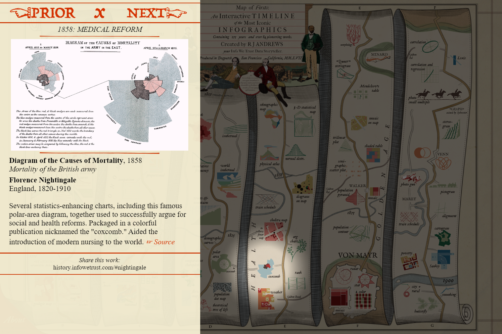
```

::: notes
<!-- Dissertation basis: §§1.1, 1.4, printed pp. 9–12 -->
There’s a long history behind these questions. This timeline is a nice reminder that people were creating sophisticated graphics well before we had the software we use today.

As the technology has changed, our ability to create and replicate graphics has grown, along with the number of design choices available to us. So the challenge is understanding how those choices affect what a viewer sees and understands.

**If useful / for questions:**

In the dissertation, I discuss the Statistical Atlas of the United States from the late 1800s as an example of high-quality graphics created without modern computing. Early recommendations for graphics also anticipated issues we still study today, including the use of lengths rather than areas and the arrangement of scales and labels.
:::

## Grammar of Graphics [@wilkinson2012grammar]

Graphics are viewed as a mapping **from variables** in the data set **to visual attributes** on the chart.

```{r}
#| out-width: 45%
#| fig-align: center
#| fig-cap: Building a masterpiece, by Allison Horst
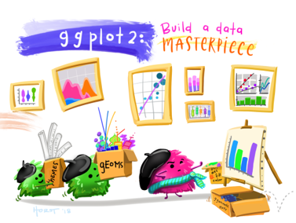
```

::: notes
<!-- Dissertation basis: §1.3, printed pp. 8–9; original Grammar of Graphics notes -->
The grammar of graphics provides a framework for describing those choices. We can view a graphic as a mapping from variables in a data set, or statistics computed from those variables, to visual attributes on a chart.

We specify how variables map to position, color, or shape, add layers, choose scales and a coordinate system, and decide how the graphic should look. Software such as ggplot2 implements this framework.

That gives us a language for constructing graphics and specifying exactly which design choice we want to evaluate.

**If useful / for questions:**

The distinction I’m especially interested in here is between the underlying data and its visual representation. Changing the axis scale changes the appearance and spacing of the data on the chart. We can then ask how that changes the task someone performs with the graphic.
:::

<!-- ORIGINAL NOTES RETAINED FOR REFERENCE
Graphics are viewed as a mapping **from variables** in the data set **to visual attributes** on the chart.

-   **aesthetics:** links between data variables and graphical features (position, color, shape, size)
-   **layers:** geometric elements (points, lines, rectangles, text, ...)
-   **transformations:** transformations specify a functional link between the data and the displayed information (identity, count, bins, density, regression). Transformations act on the variables.
-   **scales:** scales map values in data space to values in the aesthetic space. Scales change the coordinate space of an aesthetic, but don't change the underlying value (so the change is at the visual level, not the mathematical level).
-   **coordinate system:** e.g.polar or Cartesian
-   **faceting:** facets allow you to split plots by other variables to produce many sub-plots.
-   **theme:** formatting items, such as background color, fonts, margins...

Software, such as Hadley Wickham's `ggplot2`, aims to implement the framework of creating charts as the Grammar of Graphics recommends.

END ORIGINAL NOTES -->

## Gestalt Principles in Graphics

Gestalt (form or pattern) is a predictable way in which we organize sensory information.


::: {.columns}

::: {.column}

```{r}
#| out-width: 100%
#| fig-align: center
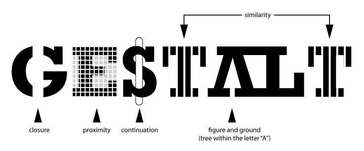
```

:::

::: {.column}

| Principle | Application in graphics |
|:----------|:------------------------|
| Enclosure | Facets |
| Connection | Lines |
| Proximity | Spacing and white space |
| Similarity | Color and shape |

:::

:::

::: notes

The grammar of graphics gives us a framework for constructing a graph. But once we put those elements together, how does a viewer organize what they see?

Gestalt principles describe some of the ways we perceive groups and patterns. We don’t interpret every point, line, or color independently—we also interpret the relationships among them.

For example, enclosing observations within a facet encourages us to see them as a group. Connecting points with a line suggests a relationship or sequence. Elements that are close together tend to be grouped, while white space can separate groups. We also tend to group elements that share a color or shape, even when they’re spread across the chart.

These principles help explain why design choices matter. We can use them to support the comparisons we want viewers to make, but they can also suggest relationships we didn’t intend.

That gives us a starting point for thinking about effective graphics. The next question is how we test whether a particular design actually helps viewers perform the task we care about.

:::

## Testing Statistical Graphics

Evaluate design choices and understand cognitive biases through the use of **visual tests**.

Could ask participants to:

`r emo::ji("graph")` identify differences in graphs.

`r emo::ji("book")` read information off of a chart accurately.

`r emo::ji("international")` use data to make correct real-world decisions.

`r emo::ji("pencil2")` predict the next few observations.

::: notes
<!-- Dissertation basis: §§1.4–1.5, printed pp. 11–16 -->
One way to establish guidelines is through the use of graphical tests. We might ask someone to identify differences between graphs, read information off a chart, use the information to make a decision, or predict the next few observations.

These tasks require different levels of use and manipulation of the information. So when we ask whether a graph is effective, we also need to ask what we want the viewer to do with it.

This field has a long history of experimentation, and the tools have continued to develop alongside the technology used to create graphics.

**If useful / for questions:**

Earlier recommendations were often grounded in heuristics. Experiments by cognitive psychologists and statisticians helped establish a basis for comparing graphical encodings, such as position, length, angle, and area. The lineup protocol builds on this experimental tradition by providing a framework for visual inference.
:::

<!-- ORIGINAL NOTES RETAINED FOR REFERENCE
One way in which we establish guidelines is through the use of graphical testing methods. This allows researchers to conduct studies geared at understanding human ability to conduct tasks related to the perception of statistical charts. These tests may take many forms such as identifying differences in graphs, accurately reading information off a chart, using data to make correct real-world decisions, or predicting the next few observations. All of these types of tests require different levels of use and manipulation of the information presented in the chart.

END ORIGINAL NOTES -->

## Task complexity

@carpenter identifies pattern recognition, interpretative processes, and integrative processes as strategies and processes required to complete tasks of varying degrees of complexity.

-   **Pattern recognition** requires the viewer to encode graphic patterns.

-   **Interpretive processes** operate on those patterns to construct meaning.

-   **Integrative processes** then relate the meanings to the contextual scenario as inferred from labels and titles.

::: notes
<!-- Dissertation basis: §1.6, printed p. 17 -->
To understand how our visual system perceives statistical charts, we first need to consider how viewers are interacting with the information.

Pattern recognition requires the viewer to encode graphic patterns. Interpretive processes operate on those patterns to construct meaning. Integrative processes then relate that meaning to the contextual scenario, including the titles, labels, and scales.

These are useful distinctions because noticing a difference between two trends doesn’t necessarily tell us whether someone can use the graph to estimate a quantity or make a prediction. We’ll see these different demands in the three studies.

**If useful / for questions:**

The dissertation also discusses cognitive fit: the representation and tools should support the strategies needed for the task. A display that makes one task easier may create additional work for another task.
:::

<!-- ORIGINAL NOTES RETAINED FOR REFERENCE
In order to understand how our visual system perceives statistical charts, we must first consider the complexity of the graphic and how viewers are interacting with the data and information being displayed. Pattern recognition requires the viewer to encode graphic patterns while interpretive processes operate on those patterns to construct meaning. Integrative processes then relate the meanings to the contextual scenario as inferred from labels and titles. We will see how these three levels of task complexity relate to the research objectives of our study.

In this section, we will take a look at how different graphical tasks are related to different levels of cognition and how that relates to my research objectives.

END ORIGINAL NOTES -->

# Lineup Protocol [@buja2009statistical] {background-color="#003831" background-opacity="0.5"}

::: notes
<!-- Dissertation basis: §§1.5, 2.2 -->
One of the tools developed for testing statistical graphics is the lineup protocol. I’ll briefly introduce how it works before showing how we used it to study log scales.
:::

## Introduction to Visual Inference

When doing exploratory data analysis, how do we know if what we see is actually there?

```{r}
#| out-width: 80%
#| fig-align: center
#| fig-width: 9
#| fig-height: 4.8
data(banknote, package = "mclust")
ggplot(banknote) + 
  geom_jitter(aes(x = Left, y = Right, color = Status)) + 
  coord_fixed() + 
  theme_bw() +
  theme(axis.text = element_blank()) +
  scale_color_manual(values = c("orange", "steelblue"))
```

::: notes
<!-- Dissertation basis: Original banknote example and visual-inference notes; §2.2 -->
When doing exploratory data analysis, how do we know if what we see is actually there?

Here we’re looking at two measurements from the banknote data, with color indicating the banknote status. We might notice some separation or structure, but we’d like a reference for deciding whether that structure is distinguishable from what we could see by chance.

That’s the idea behind visual inference.
:::

<!-- ORIGINAL NOTES RETAINED FOR REFERENCE
When inspecting a plot, how do we know if what we are seeing is actually there?

END ORIGINAL NOTES -->

## Lineup Protocol (Buja et. al, 2009)

Embed a **target plot** (actual data) in a lineup of **null plots** (randomly permuted data sets).

```{r}
#| out-width: 80%
#| fig-align: center
#| fig-width: 11
#| fig-height: 5.5
library(nullabor)
lineup(null_permute("Status"), banknote, pos = 8) %>%
ggplot() + 
  geom_jitter(aes(x = Left, y = Right, color = Status), shape = 1) + 
  facet_wrap(~.sample) + 
  coord_fixed() + 
  theme_bw() +
  theme(axis.text = element_blank()) +
  scale_color_manual(values = c("orange", "steelblue"))
```

::: notes
<!-- Dissertation basis: Original banknote code; §2.2, printed pp. 34–36 -->
One way of answering that question is to embed the actual data plot, called the target plot, within a set of null plots. In this example, those null plots come from randomly permuting the status labels.

We then ask a viewer to identify the plot that looks most different. If the target is distinguishable from the null plots, that provides evidence that the structure we noticed is visually different from the structure produced by the null-generating process.

The name comes from the law-enforcement idea of identifying a suspect from a lineup.

**If useful / for questions:**

For this banknote example, the code places the target in panel 8. In a formal evaluation, we wouldn’t reveal that position beforehand. The way we generate the null plots defines the comparison. Null plots can come from permutation or simulation; they don’t have to be generated in exactly the same way for every application.
:::

<!-- ORIGINAL NOTES RETAINED FOR REFERENCE
One way of answering this question is to embed the true data plot (called target plot) into a set of randomly permuted data sets (called null plots). This is what we call a lineup.

This is similar to the law-enforcement procedure to line up a suspect among a set of innocents to check if a victim can identify the suspect as the perpetrator of the crime.

Here, visual evaluation of the lineup is conducted by a person. If the viewers detect the target plot, we can conclude the plots are distinguishable.

The lineup protocol is one such example of the development of tools designed for statistical graphical testing. The advancement of graphing software provides the tools necessary to develop new methods of testing graphics.

END ORIGINAL NOTES -->

## Visual inference and numerical inference

```{r}
#| out-width: 40%
#| fig-align: center
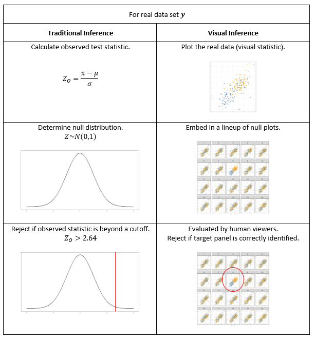
```

::: notes
<!-- Dissertation basis: §§1.5, 2.2, 2.7; original flowchart notes -->
The connection to numerical inference is that we can treat the plot as a visual statistic—a function of the data.

In a numerical test, we compare a test statistic with a reference distribution. Here, the viewer compares the target plot with plots generated under a reference model.

A useful feature is that we don’t have to specify exactly which visual difference the viewer should look for. They may notice differences in several features at once. For our purposes, that makes lineups a useful tool for comparing graphical design choices.

**If useful / for questions:**

A successful identification by one person is not automatically a complete significance analysis. Formal visual-inference calculations depend on the evaluation setting. In the dissertation study, our response of interest was correct target identification across the experimental treatments, analyzed with a mixed model.
:::

<!-- ORIGINAL NOTES RETAINED FOR REFERENCE
The main idea behind visual inference is that graphs are visual statistics or summaries of the data sets generated by mathematical functions. In a standard statistical analysis, a test statistic is generated from the data set and compared to the null distribution of that test statistic. Similarly, the visual statistic (target plot) is compared by a human viewer to other plots generated under the assumption of the null.

The main benefit of using visual inference is that visual tests tend to be more comprehensive. Since individuals are being asked to select one or more plots from a the lineup which are different but the difference is left unspecified the individual eye is actually spotting many differences at once. An equivalent numerical assessment may involved multiple tests using different test statistics.

END ORIGINAL NOTES -->

## Lineup Studies

-   [Statistical inference for exploratory data analysis and model diagnostics](https://scholar.google.com/scholar_url?url=https://royalsocietypublishing.org/doi/pdf/10.1098/rsta.2009.0120%3Fcasa_token%3DebiI2xSnDhwAAAAA:kWGCok2CLw5KQZ4_cYh_ymZwPpiJcXUc5TImyvwzBBn6C0jYtFgnYEOc0dR0kPvlajIvsuOULZpTia64&hl=en&sa=T&oi=gsb-gga&ct=res&cd=0&d=10347521957724374176&ei=W11jYaXsKYWM6rQPo_eDyAg&scisig=AAGBfm2AEQHjQU5lNQB4Lc4o81tg3SeWkQ) [@buja2009statistical]
-   [Validation of Visual Statistical Inference, Applied to Linear Models](https://scholar.google.com/scholar_url?url=https://www.tandfonline.com/doi/pdf/10.1080/01621459.2013.808157%3Fcasa_token%3DGwA4wLBPDpsAAAAA:acfwFasv03i-MlmZ7cUcD9NYkjsk2hFroGKp4SbK1ZljNN6wVBUzJyhicqplDmhMmD4LURWeqS5qm_g&hl=en&sa=T&oi=gsb-gga&ct=res&cd=0&d=3201506009084463478&ei=a11jYe6GFJ2N6rQPrdWZ4A0&scisig=AAGBfm2pYvdJa0OVNuzPLcU7ceZxogmE8w) [@majumder2013validation]
-   [Human Factors Influencing Visual Statistical Inference](https://scholar.google.com/scholar_url?url=https://www.tandfonline.com/doi/pdf/10.1080/01621459.2013.808157%3Fcasa_token%3Dy-x3yREurLYAAAAA:n2T18c7npd7rwui0SHzcmu2aa-zbeM66G7RWuPUgXG88nKzkqstOACzexskq0QhJ19yg8F2qky5w5NU&hl=en&sa=T&oi=gsb-gga&ct=res&cd=0&d=3201506009084463478&ei=gV1jYYt-gtDJBMHbsVg&scisig=AAGBfm2ZxHiHoOvYZQOJLkY9boUVKKUNvQ) [@majumder2014human]
-   [Variations of *Q*–*Q* Plots: The Power of Our Eyes!](https://scholar.google.com/scholar_url?url=https://www.tandfonline.com/doi/pdf/10.1080/00031305.2015.1077728%3Fcasa_token%3DzQIJhjnFyLkAAAAA:tKCYURplVofdEuwasvxeS3UEVUMrTYsNKDhCQ2pBkkAhyXSI-Rv9vF00OqfRi5qPYwmqZBuTKjcSdO0&hl=en&sa=T&oi=gsb-gga&ct=res&cd=0&d=10678752834182219121&ei=kF1jYdL3L4i5yQTj8oqgCg&scisig=AAGBfm0_2MwYhtf65JQetFCfaf8pTBN_1Q) [@loy2016variations]
-   [Spatial Reasoning and Data Displays](https://scholar.google.com/scholar_url?url=https://ieeexplore.ieee.org/iel7/2945/4359476/07217849.pdf%3Fcasa_token%3DXZQihG8m_RkAAAAA:twbOtOXzriTbFGFvUvrXE8dOirkb-g8boUHl-_BqoRvAfoh4pOFNPaTpWw4N-ILRlaJG8njCPf9u&hl=en&sa=T&oi=gsb-gga&ct=res&cd=0&d=1511166849179793238&ei=oF1jYY7gA5LSyQT4lJigBw&scisig=AAGBfm2lpsX7rCa8i1nFQqaMCQKkWxIqhg) [@vanderplas2015spatial]
-   [Clusters beat trend!? testing feature hierarchy in statistical graphics](https://www.tandfonline.com/doi/full/10.1080/10618600.2016.1209116?casa_token=ZTotcyTpAekAAAAA:0ZJcegDldgPo53zNw5581EKGYr5b2mtUj393V7v4OjIjhiOPN9MuiRjPdVrBvYzAoCGX3fbSpAMt5Bw) [@vanderplas2017clusters]
-   [Statistical Significance Calculations for Scenarios in Visual Inference](https://scholar.google.com/scholar_url?url=https://onlinelibrary.wiley.com/doi/pdf/10.1002/sta4.337%3Fcasa_token%3Dl3liRM4W_tcAAAAA:RM0pP8pMkbSvUvKjtCA3aQ3IBS1PfKUKyDrp62dikvMnSWdnVvWZkjqbUKVKt-uFaeZ4CLXhCnIisLhK&hl=en&sa=T&oi=gsb-gga&ct=res&cd=0&d=18231836572357450482&ei=v11jYaauD4i5yQTj8oqgCg&scisig=AAGBfm30K-gRzHdAIegMH0DH2gyiL4DfcA) [@vanderplas2021statistical]
- [Clusters, Trends, and Choices: Feature Selection in Interactive Statistical Graphics](https://doi.org/10.6339/26-JDS1221) [@le2026clusters]
- [Can You See The Change? Visual Perception in Change Point Analysis](https://doi.org/10.1080/10618600.2025.2485278) [@fudolig2025change]

::: notes
<!-- Dissertation basis: Current slide reading list; dissertation §2.2. Recent citations are from the supplied slide, not the 2022 dissertation. -->
This list gives a sense of the work that has developed around the lineup protocol, including validation, human factors, Q–Q plots, spatial reasoning, and feature hierarchy.

I’ve also included the more recent studies by Dylan Le and Miguel Fudolig that extend this work to interactive graphical features and change-point detection. I won’t go through each paper today, but I wanted to keep the full list here as a resource and to situate this dissertation work within the broader field.
:::

# "You Draw It" [@robinson2023you] {background-color="#003831" background-opacity="0.5"}

::: notes
<!-- Dissertation basis: §§3.1–3.2 -->
Another approach asks viewers to draw what they see or expect. This is the idea behind ‘You Draw It.’
:::

## "You Draw It" for News Media

```{r}
#| fig-align: center
#| out-width: 50%
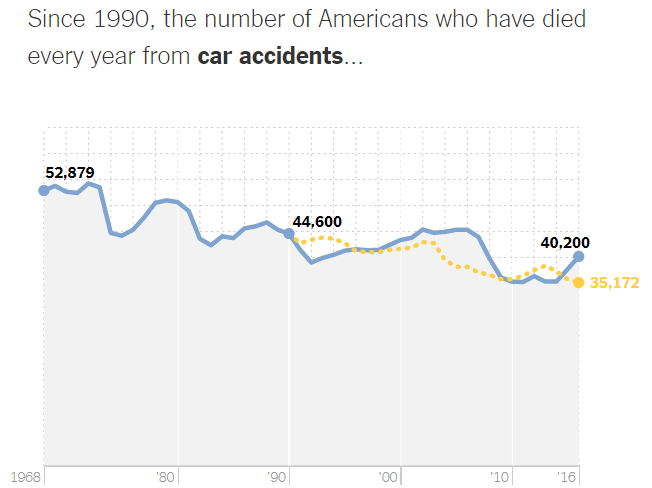
```

New York Times [@aisch_cox_quealy_2015]

::: notes
<!-- Dissertation basis: §3.1 and original You Draw It task notes -->
In 2015, the New York Times introduced an interactive feature called ‘You Draw It.’ Readers could draw their own expectations about a trend and then compare those expectations with the data.

That feature gave us a way to think about collecting a visual response directly. Rather than asking someone to describe a trend in words or choose from a set of answers, we can ask them to draw a line.
:::

## "You Draw It" for Graphical Testing

```{r}
#| fig-align: center
#| out-width: 45%
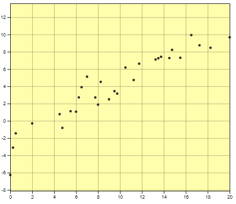
```

[Eye Fitting Straight Lines in the Modern Era](https://www.tandfonline.com/doi/abs/10.1080/10618600.2022.2140668) [@robinson2022eye]

[youdrawitR](https://alisa-krasilnikov.github.io/youdrawitR/) Package by Alisa Krasilnikov

<!-- Log-scale motivation, objectives and study setting: about 3 minutes. -->

::: notes
<!-- Dissertation basis: §§3.2–3.3, printed pp. 55–64; §3.5, pp. 71–73. Current slide attributes youdrawitR to Alisa Krasilnikov. -->
We adapted that idea as a tool for graphical testing. In the eye-fitting study, we asked participants to draw a line through points and compared their visual fits with statistical regression results.

This replicated earlier work by Mosteller and colleagues using a modern interactive interface. Participants tended to fit a line closer to the slope of the first principal component than the ordinary least squares line, particularly when the data had more variability.

That replication helped establish ‘You Draw It’ as a method we could then use to study prediction. The youdrawitR package listed here is another resource for implementing these tasks.

**If useful / for questions:**

A useful feature of this approach is that the response is a series of drawn points, which lets us study how a person’s fit changes along the domain. In the dissertation, we introduced generalized additive mixed models to compare these drawn lines with statistical reference fits.
:::

# Perception of Logarithmic Scales {background-color="#003831" background-opacity="0.5"}

::: notes
<!-- Dissertation basis: §§1.8–1.10 -->
With those tools in mind, I’m going to focus on one design choice: displaying exponentially increasing data on a logarithmic scale.
:::

## Logarithmic Mapping

::: {.figure-wide}
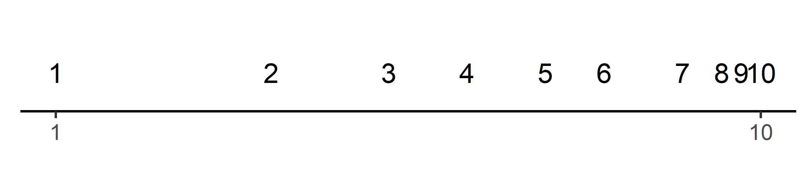
:::

::: notes
<!-- Dissertation basis: §1.8, printed pp. 25–28; Figure 1.20 -->
There’s an interesting tension in how we think about log scales. Research on number-line mapping suggests that numerical representations can be compressed, approximately logarithmic, early in development, with a transition toward linear mapping through education and experience.

Here, for example, three falls much closer to the middle of the compressed number line than it does on the linear one.

That gives us a reason to ask whether a compressed scale might feel natural in some settings. But it doesn’t establish that someone will be able to read a log-scaled chart accurately. That’s something we need to test.

**If useful / for questions:**

The dissertation connects this idea to the Weber–Fechner relationship between relative changes in a stimulus and perceived intensity. I treat that as motivation for the research rather than assuming that sensory perception, number-line mapping, and graph comprehension are interchangeable.
:::

<!-- ORIGINAL NOTES RETAINED FOR REFERENCE
<!-- Original speaker notes: index.rmd / Logarithmic scales --&gt;
A major issue we encountered in the creation of COVID-19 plots was how to display data from a wide range of values.

+ **Problem:** Data which spans several orders of magnitude shown on its original scale compresses the smaller magnitudes into relatively little area.
+ **Solution:** Use of a log scale transformation; alters the contextual appearance of the data.

<!-- Original speaker notes: index.rmd / Logarithmic mapping --&gt;
When we first learn to count, we begin counting by ones, then by tens, and advancing to hundreds, following the base10 order of magnitude system.

Research shows our perception and mapping of numbers to a number line is **logarithmic at first**, but transitions to a **linear scale later** in development, with formal mathematics education.
+ For example: A kindergartner asked to place numbers one through ten along a number line would place three close to the middle, following the logarithmic perspective.

Regardless of training, we also know our visual system is vulnerable to biases related to different stimuli such as weight, light, or sound. Weber's law established that we do not notice absolute changes in stimuli, but instead, we notice the relative change. For example, if the volume of a speaker is set quiet and you turn it up slightly, you are going to think the change was large compared to if the volume of the speaker was already blasting and you turned it up the same amount as when it was quiet. The Weber-Fechner law extended this discovery and stated that the relationship between the perceived intensity (as sensed by the person) is logarithmic to the stimulus intensity (as outputted by the object source) when observed above a minimal threshold of perception.

Assuming there is a direct relationship between perceptual and cognitive processes, it is reasonable to assume numerical representations should also be displayed on a nonlinear, compressed number scale. Therefore, if we perceive logarithmically by default, it is a natural (and presumably low effort) way to display information and should be easy to read and understand/use.

END ORIGINAL NOTES -->

## Exponential Growth

@vonbergmann_2021

```{r}
#| fig-align: center
#| out-width: 75%
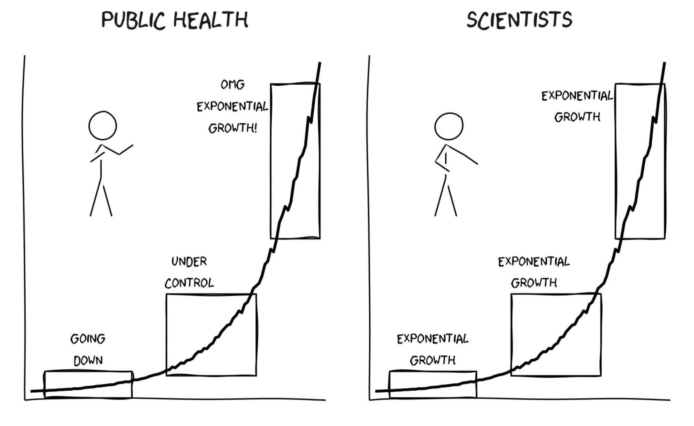
```

::: notes
<!-- Dissertation basis: §§1.1, 1.9, printed pp. 29–30; original Exponential Growth notes -->
The motivation for this work came largely from the impact graphics had during the COVID-19 pandemic. Those graphics helped communicate what was happening and informed decisions, so the choices involved in displaying growth mattered.

This comic illustrates a general misinterpretation of exponential growth. Early on it can look like very little is happening. By the time the growth looks unmistakably rapid, the situation has changed substantially.

That led us to ask whether the way we display exponential growth affects what people perceive and how they use the information.

**If useful / for questions:**

Earlier studies found underestimation of exponential growth with both numerical and graphical presentations. Instruction or feedback can improve some predictions, but familiarity with exponential growth alone does not remove the problem. Our question is how the scale used to display the data affects these judgments.
:::

<!-- ORIGINAL NOTES RETAINED FOR REFERENCE
<!-- Original speaker notes: index.qmd / Exponential Growth --&gt;
The motivation for this work came largly from the impact graphics and charts have had during the COVID-19 pandemic. Many of these graphics helped guide decision makers to implement policies such as shut-downs or mandated mask wearing, as well as facilitated communication with the public to increase compliance.

As graphics began to play an important role in sharing information with the public, it was crucial to start asking what made some of these charts better than others? Creators of the graphics were faced with many design choices in order to ensure their charts were effective at accurately communicating the current status of the pandemic.

A major issue we encountered in the creation of COVID-19 plots was how to display data from a wide range of values.

-   **Problem:** Data which spans several orders of magnitude shown on its original scale compresses the smaller magnitudes into relatively little area.
-   **Solution:** Use of a log scale transformation; alters the contextual appearance of the data.

However, as shown here, there is a **general misinterpretation of exponential growth**. This visual illustrates how individuals in public health may interpret exponential growth distinctly different from scientists during early, middle, and late stages of growth.

As Susan indicated, in order to make educated decisions when designing a chart, we need to establish guidelines through experimentation in order to ensure the graphic is effective at communicating the intended results.

<!-- Original speaker notes: index.rmd / Motivation --&gt;
The motivation for this work came from the large impact graphics and charts have had during the COVID-19 pandemic. Many of these graphics helped guide decision makers to implement policies such as shut-downs or mandated mask wearing, as well as facilitated communication with the public to increase compliance. 

As graphics began to play an important role in sharing information with the public, it was crucial to start asking what made some of these charts better than others? Creators of the graphics were faced with many design choices in order to ensure their charts were effective at accurately communicating the current status of the pandemic.

In order to make educated decisions when designing a chart, we need to establish guidelines through experimentation in order to ensure the graphic is effective at communicating the intended results.

<!-- Original speaker notes: index.rmd / Exponential growth --&gt;
In addition to biases which result from the use of log scales, there is a **general misinterpretation of exponential growth**. This visual illustrates how individuals in public health interpret exponential growth distinctly different from scientists during early, middle, and late stages of growth. 

Early studies explored the estimation and prediction of exponential growth and found that *growth is underestimated** when presented both numerically and graphically.

**Can log transforming the data help?**

+ Maybe, but are there consequences? 
+ Most readers are not mathematically sophisticated enough to intuitively understand logarithmic math and translate that back into real-world effects.

END ORIGINAL NOTES -->

## Benefits and pitfalls of log scales

@burnmurdoch_2020 <!-- **Benefits** were seen in spring 2020, during the early stages of the COVID-19 pandemic. -->

<!-- **Pitfalls** were exposed as the pandemic evolved, and the case counts were no longer spreading exponentially. -->

::: r-stack
```{r}
#| out-width: 70%
#| fig-align: center
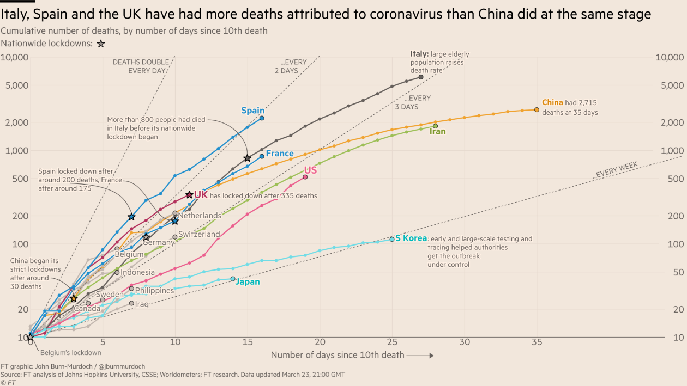
```

::: fragment
```{r}
#| out-width: 70%
#| fig-align: center
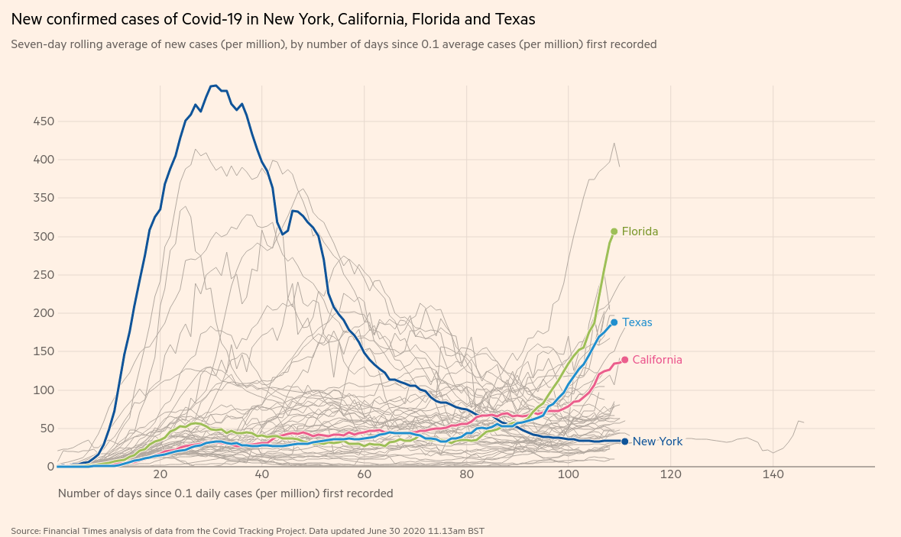
```
:::

::: fragment
```{r}
#| out-width: 70%
#| fig-align: center
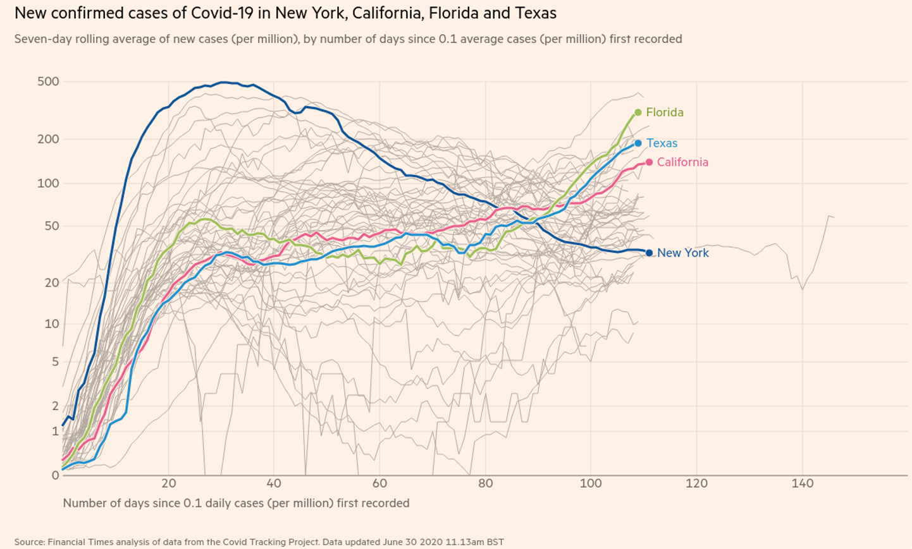
```
:::
:::

::: notes
<!-- Dissertation basis: §1.8, printed pp. 23–27; Figures 1.17–1.19 -->
A major issue in displaying COVID-19 data was the wide range of values. On a linear scale, smaller magnitudes can be compressed into very little space. A log scale lets us show places with very different case counts within one graph.

But the scale also changes the contextual appearance of the data. As the pandemic evolved, a linear display could make renewed increases in daily cases more visually apparent, while a log display emphasized proportional relationships.

These examples show why we need to consider both the information we want to communicate and what we expect the viewer to do with the graph.

**If useful / for questions:**

On the first image, point out the usefulness of comparing countries at very different magnitudes. With the next two images, focus on how the same data appear under different scales. The dissertation describes the apparent public reaction as motivation; this was not an experimental result from our study.
:::

<!-- ORIGINAL NOTES RETAINED FOR REFERENCE
<!-- Original speaker notes: index.qmd / Benefits and pitfalls of log scales --&gt;
**Benefits** were seen in spring 2020, during the early stages of the COVID-19 pandemic.

-   Large magnitude discrepancies in case counts at a given time point between different geographic regions.
-   Log scale transformations were usefulness for showing case count curves for areas with few cases and areas with many cases within one chart.

**Pitfalls** were exposed as the pandemic evolved, and the case counts were no longer spreading exponentially.

-   Graphs with linear scales seemed more effective at spotting early increases in case counts that signaled more localized outbreaks.
-   The effect of the linear scale appears to evoke a stronger reaction from the public than the log scale.

While this is one such example, there is a long history of using log scales to display results in ecology, psychophysics, engineering, and physics. Given the widespread use of logarithmic scales, it is important to understand the implications of their use in order to provide guidelines for best use.

<!-- Original speaker notes: index.rmd / Benefits and pitfalls of log scales --&gt;
**Benefits** were seen in spring 2020, during the early stages of the COVID-19 pandemic.

+ Large magnitude discrepancies in case counts at a given time point between different geographic regions.
+ Log scale transformations were usefulness for showing case count curves for areas with few cases and areas with many cases within one chart.

**Pitfalls** were exposed as the pandemic evolved, and the case counts were no longer spreading exponentially.

+ Graphs with linear scales seemed more effective at spotting early increases in case counts that signaled more localized outbreaks.
+ The effect of the linear scale appears to evoke a stronger reaction from the public than the log scale.

While this is one such example, there is a long history of using log scales to display results in ecology, psychophysics, engineering, and physics. Given the widespread use of logarithmic scales, it is important to understand the implications of their use in order to provide guidelines for best use.

END ORIGINAL NOTES -->

## Research objectives

**Big Idea:** Are there benefits to displaying exponentially increasing data on a log scale rather than a linear scale?

::: incremental
1.  **Perception through Lineups** `r fa("chart-line")` `r fa("chart-line")` `r fa("chart-line")` -- tests an individual's ability to perceptually differentiate exponentially increasing data with differing rates of change on both the linear and log scale.

2.  **Prediction with 'You Draw It'** `r fa("pencil")` -- tests an individual's ability to make predictions for exponentially increasing data.

3.  **Estimation by Numerical Translation** `r fa("ruler")` -- tests an individual's ability to translate a graph of exponentially increasing data into real value quantities.
:::

::: fragment
The series of graphical tests were conducted through an RShiny application found at <https://emily-robinson.shinyapps.io/perception-of-statistical-graphics-log/>.
:::

::: notes
<!-- Dissertation basis: §1.10, printed pp. 32–33; original Research objectives notes -->
The big question was whether there are benefits to displaying exponentially increasing data on a log scale rather than a linear scale.

We evaluated that through three graphical tasks. First, can someone perceptually distinguish between exponentially increasing trends? Second, can they predict how a trend continues? Third, can they translate the graph into numerical quantities and use those estimates to make comparisons?

Together, these studies provide a more comprehensive evaluation than we would get from any one task on its own.
:::

<!-- ORIGINAL NOTES RETAINED FOR REFERENCE
<!-- Original speaker notes: index.qmd / Research objectives --&gt;
In this research, we conducted a series of three graphical studies to evaluate the impact displaying data on the log scale has on human perception of exponentially increasing trends compared to displaying data on the linear scale. Each study was related to a different graphical task, each requiring a different level of interaction and cognitive use of the data being presented.

1.  The first experiment evaluated whether our ability to perceptually notice differences in exponentially increasing trends is impacted by the choice of scale. These perceptual differences are identified through pattern recognition.
2.  The second study tested an individuals ability to make predictions for exponentially increasing data and required integrative processes by operate on the patterns to construct meaning.
3.  The last and third study tested an individual's ability to translate a graph of exponentially increasing data into real value quantitites and extend these estmiates by making comparisons.

Combined, the three studies provide a comprehensive evaluation of the impact of displaying exponentially increasing data on a log scale as it relates to perception, prediction, and estimation. The results of these studies help us make recommendations and provide guidelines for the use of log scales.

<!-- Original speaker notes: index.rmd / Research objectives --&gt;
In this research, we conducted a series of three graphical studies to evaluate the impact displaying data on the log scale has on human perception of exponentially increasing trends compared to displaying data on the linear scale. Each study was related to a different graphical task, each requiring a different level of interaction and cognitive use of the data being presented. 

1. The first experiment evaluated whether our ability to perceptually notice differences in exponentially increasing trends is impacted by the choice of scale. These perceptual differences are identified through pattern recognition.
2. The second study tested an individuals ability to make predictions for exponentially increasing data and required integrative processes by operate on the patterns to construct meaning.
3. The last and third study tested an individual's ability to translate a graph of exponentially increasing data into real value quantitites and extend these estmiates by making comparisons.

Combined, the three studies provide a comprehensive evaluation of the impact of displaying exponentially increasing data on a log scale as it relates to perception, prediction, and estimation. The results of these studies help us make recommendations and provide guidelines for the use of log scales.

<!-- Original speaker notes: index.rmd / Prolific data collection --&gt;
Pilot studies have been conducted throughout this research to test out the studies. Many of you were participants in some of these pilot studies. 

The final participant recruitment and study deployment were conducted via Prolific, a crowd sourcing website, in March 2022. Participants were provided a link to an R Shiny application that asked them demographic information and then guided them through all three studies. For the final data collection, we collected data for about 300 participants for each study; this was the final data set used for analysis in my research.

END ORIGINAL NOTES -->

#  {background-image="images/study-homepage.jpg" background-size="contain"}

::: notes
<!-- Dissertation basis: §2.6–2.7, printed pp. 41–42; §3.2, p. 56; §4.4, p. 81 -->
The studies were conducted through an R Shiny application, with participant recruitment through Prolific in March 2022. Participants completed the lineup, ‘You Draw It,’ and estimation tasks in that order.

There were roughly 300 participants in each part of the study. I’ll focus on the tasks and results rather than walking through the application itself.

**If useful / for questions:**

The dissertation reports 311 participants in the final lineup analysis, 309 completing exponential-prediction task plots, and 302 completing the estimation study. Those are study-specific counts, so I’m using ‘roughly 300’ for the overall description.
:::

<!-- ORIGINAL NOTES RETAINED FOR REFERENCE
<!-- Original speaker notes: index.qmd /  --&gt;
The final participant recruitment and study deployment were conducted via Prolific, a crowd sourcing website, in March 2022. Participants were provided a link to an R Shiny application that asked them demographic information and then guided them through all three studies. For the final data collection, we collected data for about 300 participants for each study; this was the final data set used for analysis in my research.

END ORIGINAL NOTES -->

## Lineup Experimental Task

:::: {.columns .figure-pair}

::: {.column width="50%"}
### Linear scale
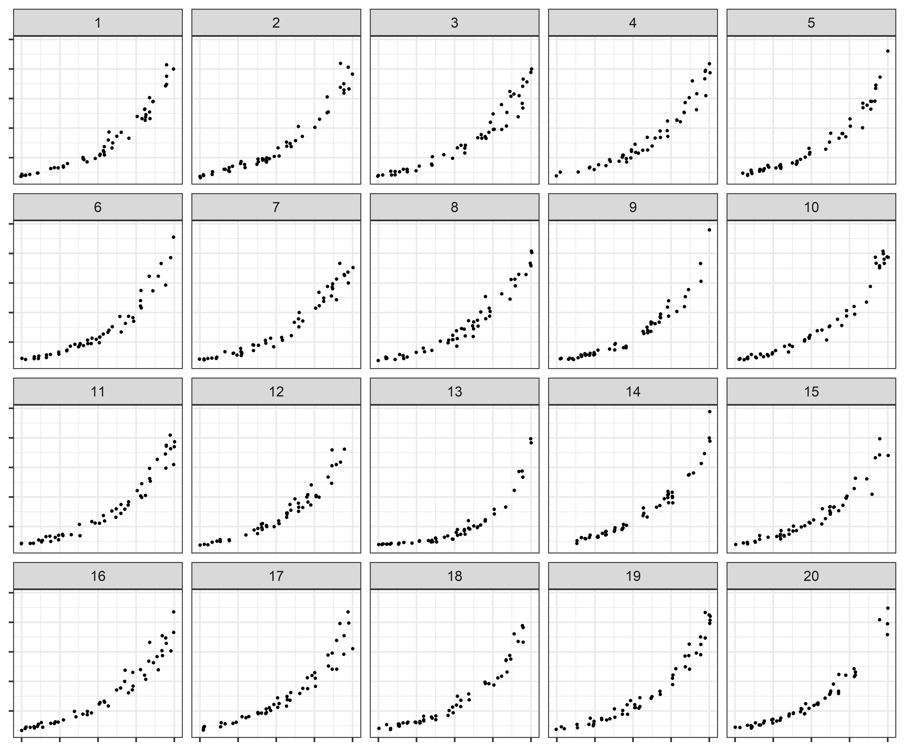
:::

::: {.column width="50%"}
### Log scale
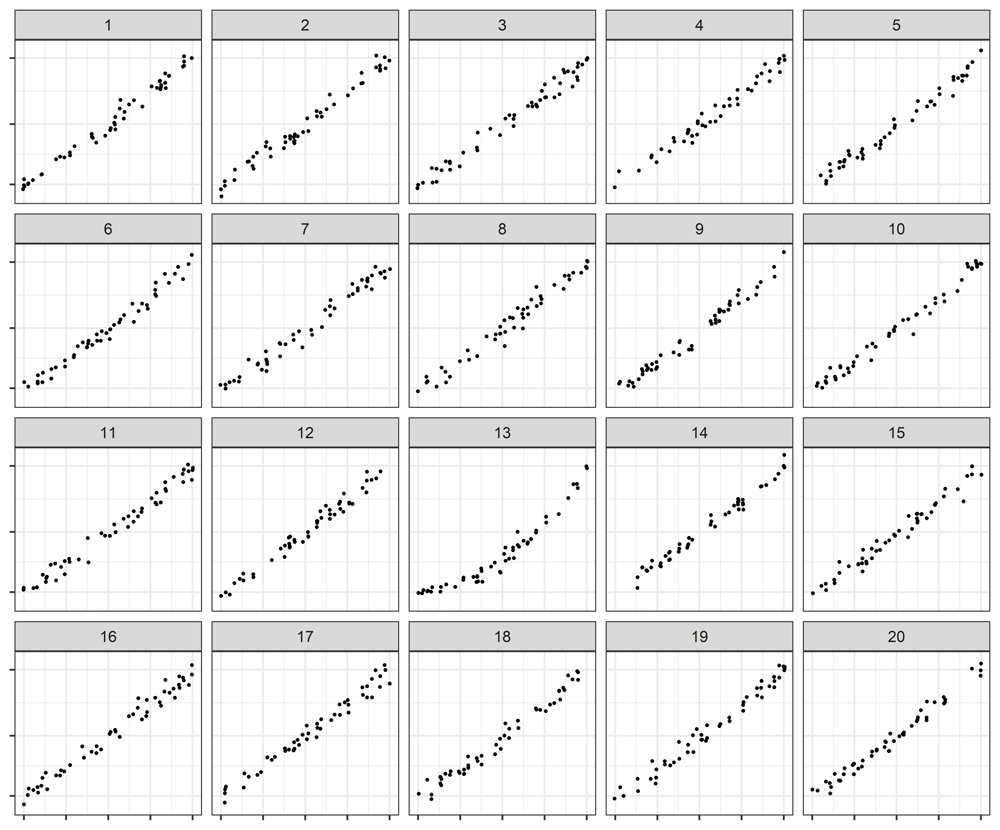
:::

::::

::: {.takeaway}
Outcome: successful identification of the target panel.
:::

::: notes
<!-- Dissertation basis: §§2.2–2.3, printed pp. 34–37; §2.6, p. 41 -->
For the first study, participants saw a series of lineups and were asked, ‘Which plot is most different?’

Here we see examples on the linear and log scales. The task tests whether the viewer can distinguish differences in the trends’ curvature. It doesn’t require them to estimate a population, identify the scale, or interpret a real-world scenario.

An important detail is that both the target and comparison data were simulated. We constrained the domain and range to be similar so that the comparison focused on the appearance of the trend rather than different starting or ending values.

**If useful / for questions:**

The dissertation’s example lineups have different target positions: panel 13 on the linear-scale example and panel 4 on the log-scale example. Don’t assume the target stays in the same panel across these displays. Participants also justified their choice and rated their confidence, although correct identification is the response used in this analysis.
:::

<!-- ORIGINAL NOTES RETAINED FOR REFERENCE
<!-- Original speaker notes: index.qmd / Graphical Tasks --&gt;
We used statistical lineups to test participants perception of exponentially increasing data.

Here we see an example of statistical lineups as shown in the first study. Notice how it is much easier to pick out panel 13 as being most different when displayed on the log scale (right) than on the linear scale (left).

In 2015, the New York Times introduced an interactive feature, called 'You Draw It', where readers input their own assumptions about various metrics and compare how these assumptions relate to reality. The Times team utilizes Data Driven Documents (D3) that allows readers to predict these metrics through the use of drawing a line on their computer screen with their mouse. We adapted this feature as a way to measure the patterns we see in data and compare intuitive visual model fitting and statistical model fitting. In the study, participants were shown a series of 'You Draw It' interactive task plots and asked to "Use your mouse to fill in the trend in the yellow box region." The yellow box region moves along as the participant draws their trend-line until the yellow region disappears, providing a visual cue for the task.

<!-- Original speaker notes: index.rmd / Perception through Lineups --&gt;
I previously presented development processes and pilot study results for the first two chapters so I am going to briefly share a high level overview of the study and final data set results for these.

<!-- Original speaker notes: index.rmd / Lineup experimental task --&gt;
We used statistical lineups to test participants perception of exponentially increasing data. 'Lineups' are named after the 'police lineup' of criminal investigations where witnesses are asked to identify the criminal from a set of individuals. Similarly, a statistical lineup is a plot consisting of smaller panels where the viewer is asked to identify the panel containing the real data from among a set of decoy null plots. 

Here we see an example of statistical lineups as shown in the first study. Notice how it is much easier to pick out panel 13 as being most different when displayed on the log scale (right) than on the linear scale (left).

END ORIGINAL NOTES -->

## Lineup Study Design and Generalized Linear Mixed Model

:::: {.columns}

::: {.column width="42%"}
**Treatment design**

Three curvature levels resulting in six curvature combinations.

Two data replicates $\times$ two scales give 24 candidate lineups.

Each participant evaluates 12 lineups.
:::

::: {.column width="58%" .math-slide}
**Binary response GLMM**

$$\text{logit }P(Y_{ijk}) = \eta + \delta_i + \gamma_j + \delta \gamma_{ij} + s_l + d_k$$

Scale × curvature fixed effects.

Participant and simulated-data random intercepts.
:::

::::

::: notes
<!-- Dissertation basis: §§2.4–2.7, printed pp. 37–43 -->
We used a ‘Goldilocks’ approach to select low, medium, and high levels of curvature. Combining each target curvature with a different comparison curvature gave six ordered combinations.

We simulated two replicates of each combination and displayed them on both scales, giving 24 candidate lineups. Each participant evaluated the six combinations on both scales.

For analysis, correct target identification was a binary response. We fit a generalized linear mixed model with scale, curvature combination, and their interaction, along with random effects for participant and data set. The interaction lets the effect of scale depend on which trends are being compared.

**If useful / for questions:**

The slide refers to the 12 test lineups. Participants also saw one homogeneous Rorschach lineup, so there were 13 presentations in total; the Rorschach responses were not analyzed in this chapter. Participants received one replicate for each curvature combination and saw it on both scales, with presentation order randomized.

The dissertation reports a strong scale-by-curvature interaction, with chi-squared = 294.443 on 5 degrees of freedom and p < 0.0001. This is useful if asked about the statistical evidence behind the comparison.
:::

## Lineup Results

::: {.figure-wide}
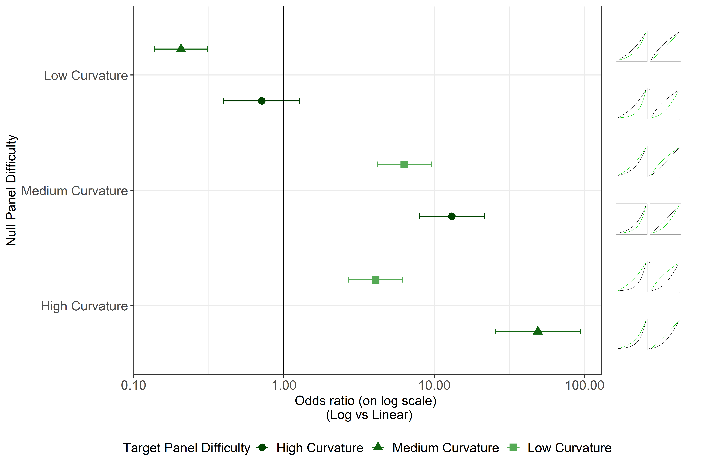
:::


::: {.takeaway}
Neither scale has a uniform advantage across these comparisons.
:::

::: notes
<!-- Dissertation basis: §2.7, printed pp. 42–45; §2.8, pp. 45–46; Figure 2.4 and supplied HTML figure checked -->
This figure shows the odds of correctly identifying the target on the log scale relative to the linear scale. The vertical reference at one represents equal odds. Values to the right favor the log display, and values to the left favor the linear display.

The scale comparison depends on the curvature combination. There’s an advantage for the log scale in several comparisons, but an exception when a medium-curvature target appears among low-curvature comparison plots.

The thumbnails help explain that exception. Changing the scale changes which trend appears more curved. Our results support the idea that it’s easier to identify a curve among lines than a line among curves.

**If useful / for questions:**

The horizontal axis shows odds ratios on a logarithmic axis, not log-odds-ratio values. The null-panel curvature is on the vertical axis, and shape and shade identify the target curvature. For a high-curvature target among low-curvature comparisons, the interval includes one. This does not prove equivalence; it means the contrast does not show a clear scale advantage in that condition.

The dissertation reports overall target-identification percentages of 47% on the linear scale and 65.3% on the log scale. Those pooled percentages do not replace the interaction-specific interpretation shown here.
:::

<!-- ORIGINAL NOTES RETAINED FOR REFERENCE
<!-- Original speaker notes: index.qmd / Lineup Protocal [@buja2009statistical] --&gt;
Efforts in the field of graphics have developed graphical testing tools and methods such as the lineup protocol to provide a framework for inferential testing.

<!-- Original speaker notes: index.rmd / Lineup results --&gt;
Estimated (log) odds ratio of successfully identifying the target panel on the log scale compared to the linear scale. The y-axis indicates the the model parameters used to simulate the null plots with the target plot model parameter selection designated by shape and shade of green. The thumbnail figures on the right display the curvature combination as shown previously on both scales (linear - left, log - right).

The results indicated the choice of scale changes the contextual appearance of the data leading to slight perceptual advantages for both scales depending on the curvatures of the trend lines being compared.

END ORIGINAL NOTES -->

## 'You Draw It' Experimental Task

:::: {.columns .figure-pair}

::: {.column width="43%"}
*“Use your mouse to fill in the trend in the yellow box region.”*

The response is an entire drawn curve.

Compare participants’ visual forecasts with a statistically fitted reference curve.

[@robinson2022eye; @robinson2023you]
:::

::: {.column width="57%"}
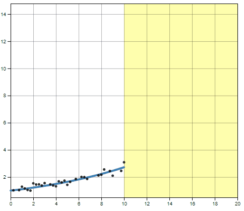
:::

::::

::: notes
<!-- Dissertation basis: §§3.1, 3.4, printed pp. 47, 64–68; original task notes -->
The lineup study establishes whether people can see a difference. Next, we wanted to know whether they could use the visible pattern to make a prediction.

In the ‘You Draw It’ task, participants were asked to use their mouse to fill in the trend in the yellow region. We record the drawn line, which gives us a response across the prediction domain rather than just a single answer.

We can then compare each participant’s visual forecast with a statistical reference fit to the data they saw.
:::

<!-- ORIGINAL NOTES RETAINED FOR REFERENCE
<!-- Original speaker notes: index.rmd / Prediction through 'You Draw It' --&gt;
The second study evaluated participants ability to make forecast predictions of exponentially increasing data.

<!-- Original speaker notes: index.rmd / 'You Draw It' experimental task --&gt;
In 2015, the New York Times introduced an interactive feature, called ‘You Draw It’, where readers input their own assumptions about various metrics and compare how these assumptions relate to reality. The Times team utilizes Data Driven Documents (D3) that allows readers to predict these metrics through the use of drawing a line on their computer screen with their mouse. We adapted this feature as a way to measure the patterns we see in data and compare intuitive visual model fitting and statistical model fitting. In the study, participants were shown a series of 'You Draw It' interactive task plots and asked to "Use your mouse to fill in the trend in the yellow box region." The yellow box region moves along as the participant draws their trend-line until the yellow region disappears, providing a visual cue for the task.

<!-- Original speaker notes: index.rmd / 'You Draw It' experimental task --&gt;
A sub-study validated a new method, 'You Draw It', as a tool for graphical testing statistical graphics and introduced an appropriate statistical analysis method for comparing visually fitted trend lines to statistical regression results. We are working on revisions for the manuscript related to this sub-study.

END ORIGINAL NOTES -->

## 'You Draw It' Treatment Design

$y_i=e^{\beta x_i+e_i},\quad e_i\sim N(0,\sigma^2),\quad N=30$

2 $\times$ 2 $\times$ 2: growth rate $\times$ point truncation $\times$ display scale.

:::: {.columns .figure-grid}

::: {.column width="50%"}
### Low growth · Linear
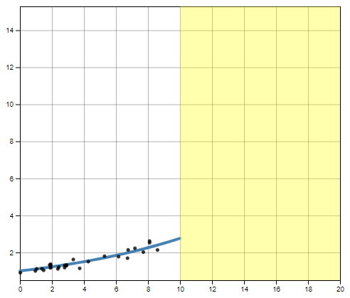

### High growth · Linear
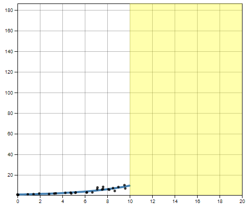
:::

::: {.column width="50%"}
### Low growth · Log
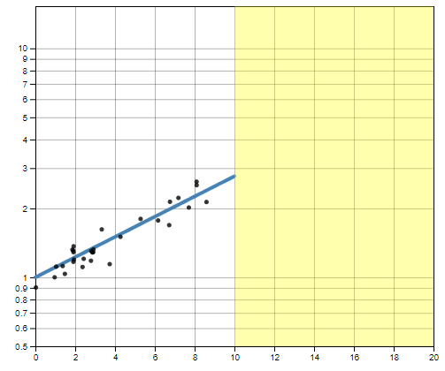

### High growth · Log
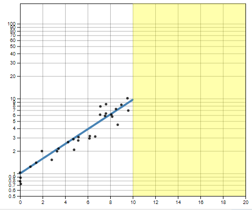
:::

::::

::: notes
<!-- Dissertation basis: §3.2, printed pp. 55–56; §3.4.1, pp. 67–68 -->
For this study, we simulated 30 points from a one-parameter exponential model with multiplicative error. We varied growth rate, the amount of the domain over which points remained visible, and the display scale.

Each participant began drawing halfway through the domain. In one condition, the points stopped at that halfway point; in the other, they continued through 75% of the domain. That let us compare predictions with and without additional visual guidance.

The two growth rates, two point-truncation conditions, and two scales gave eight treatment combinations.

**If useful / for questions:**

The growth-rate settings were beta = 0.10 with sigma = 0.09, and beta = 0.23 with sigma = 0.25. Each participant had a low-growth and high-growth data set, each shown under four display conditions. The eight exponential task plots were interspersed with four eye-fitting task plots in randomized order. We allowed space beyond the data range so participants could draw outside it.
:::

<!-- ORIGINAL NOTES RETAINED FOR REFERENCE
<!-- Original speaker notes: index.rmd / Treatment design --&gt;
For this study, data were simulated based on a one-parameter exponential model. We designed a 2x2x2 factorial treatment design where we are looking at the effect of growth rate, having the aid of points, and of course the effect of scale. This creates a total of 8 treatment combinations for 'You Draw It' plots in which participants were shown in random order.

END ORIGINAL NOTES -->

## Prediction Feedback Data

::: {.figure-wide}
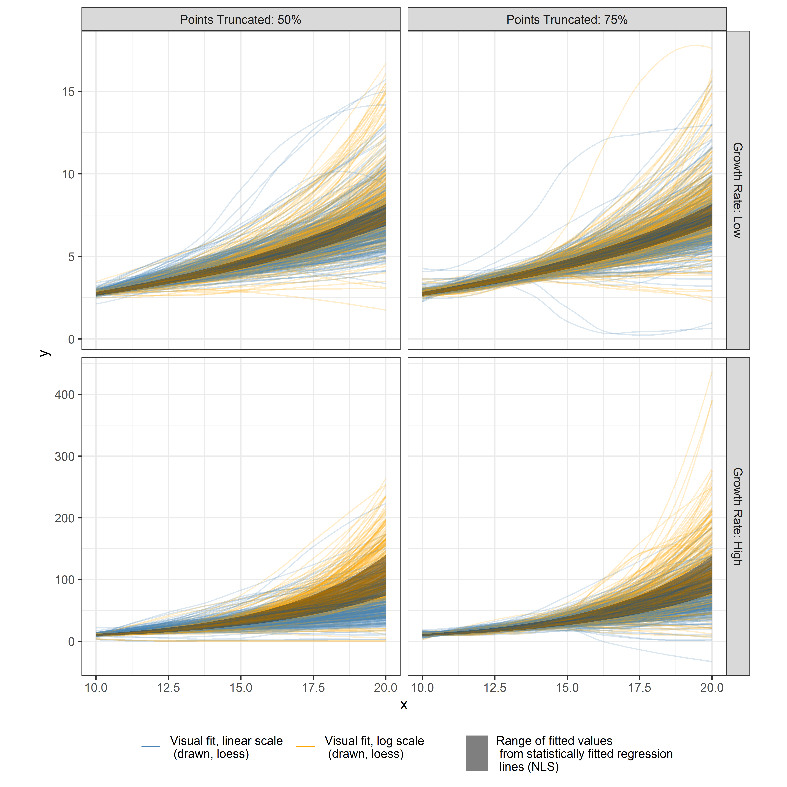
:::

::: notes
<!-- Dissertation basis: §3.4.2, printed pp. 68–70; Figure 3.11 -->
Here we see the participant-drawn lines, with a LOESS smoother used to help visualize the individual responses. Blue indicates drawings made on the linear scale, and orange indicates drawings made on the log scale.

The gray band shows the range of nonlinear least squares fitted values. That range reflects the different data sets simulated for individual participants.

The underestimation on the linear scale is most apparent in the high-growth condition. When points remain visible through 75% of the domain, that underestimation starts later, after the visual aid of the points is removed.

**If useful / for questions:**

For analysis, we calculate vertical residuals as the drawn value minus the nonlinear least squares fitted value for the participant’s data set. A negative residual means the drawing is below that fitted reference. This distinguishes disagreement with the reference fit from variability in the simulated data themselves.
:::

<!-- ORIGINAL NOTES RETAINED FOR REFERENCE
<!-- Original speaker notes: index.rmd / Feedback data --&gt;
Out of the study, we save the participant feedback data to a data base for analysis. Here we see a spaghetti plots of results. Participants drawn lines on the linear scale are shown in blue and the log scale are shown in orange. Variability in the statistically fitted regression lines occurred due to a unique data set being simulated for each individual; the gray band shows the range fitted values from the statistically fitted regression lines. Here we can see a strong underestimation on the linear scale (blue lines).

END ORIGINAL NOTES -->

## Generalized Additive Mixed Model {.math-slide}

Fit separately for each growth rate (low = 1, high = 2):

$$e_{1jklm,NLS}=\tau_{1jk}+s_{1jk}(x_{1jklm})+p_l+s_l(x_{1jklm})$$
$$e_{2jklm,NLS}=\tau_{2jk}+s_{2jk}(x_{2jklm})+p_l+s_l(x_{2jklm})$$

- $j$: point truncation, $k$: scale, $l$: participant, $m$: location.
- $\tau_{\cdot jk}$ and $s_{\cdot jk}$: treatment intercept and smoothing spline.
- $p_l\sim N(0,\sigma^2_\text{participant})$: participant random intercept.
- $s_l$: participant random smoothing spline.

::: notes
<!-- Dissertation basis: §3.4.2, printed pp. 69–71; Equations 3.5–3.6 -->
To analyze these drawn curves, we fit generalized additive mixed models to the vertical residuals between each participant’s drawing and the nonlinear least squares reference fit.

We fit separate models for low and high growth because the magnitudes of the variation were so different. Within each model, point truncation and scale define the treatment combinations, with an intercept and a smooth over x for each combination.

We also account for participant variation through random intercepts and random smoothing splines. The smooths let us examine how the deviation changes over the prediction domain without requiring it to follow a straight line.

**If useful / for questions:**

In the notation on the slide, j is point truncation, k is scale, l is participant, and m is location. The tau terms and treatment-specific smooths describe the average residual pattern, while p_l and s_l describe participant variation. The dissertation used bam from mgcv. There was no common overall intercept in addition to the treatment-combination intercepts.
:::

<!-- ORIGINAL NOTES RETAINED FOR REFERENCE
<!-- Original speaker notes: index.rmd / Generalized Additive Mixed Model --&gt;
Allowing for flexibility, the we fit a Generalized Additive Mixed Model to estimate smoothing splines for the vertical residuals from the participant drawn line in relation to the NLS fitted values. We included an intercept related to each treatment combination along with a smoothing spline adjustment for each treatment combination. We accounted for participant variability with random intercept and random spline effects.

END ORIGINAL NOTES -->

## GAMM Results

::: {.figure-wide}
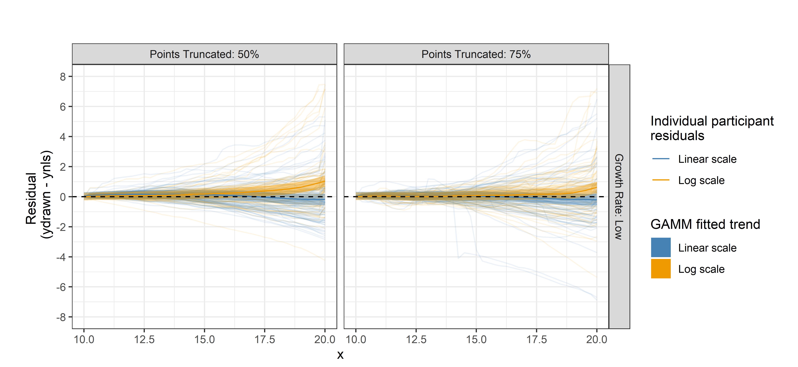
:::

::: notes
<!-- Dissertation basis: §3.4.2, printed pp. 70–72; Figure 3.12. Supplied HTML confirms this slide contains Growth Rate: Low. -->
These are the fitted residual trends for the low-growth condition. The dashed horizontal line at zero represents agreement with the nonlinear least squares reference fit. Individual participant residuals are shown faintly in the background.

Here, the departures are relatively small. We see some underestimation on the linear display and some overestimation on the log display toward the end of the domain. The scale difference is more pronounced for the high-growth condition, which we saw in the spaghetti plot and which is also included in the additional results.

So I’d be careful about describing the log scale as uniformly better in every condition.

**If useful / for questions:**

For a question about the main prediction finding, the high-growth residual figure is in the backup slide ‘GAMM Results (continued).’ There, the linear-scale fitted residuals move further below zero after the points disappear, while log-scale predictions stay closer to the fitted reference. These plotted deviations are in the original response units, even when participants drew on a log-scaled display.
:::

<!-- ORIGINAL NOTES RETAINED FOR REFERENCE
<!-- Original speaker notes: index.rmd / GAMM results --&gt;
The results from the analysis showed a clear underestimation of forecasting trends with high exponential growth rates when participants were asked to make predictions on the linear scale.

END ORIGINAL NOTES -->

## Numerical Translation and Estimation: Data and Plot Generation

:::: {.columns .figure-pair}

::: {.column width="45%"}
Two simulated data sets:

$$y_i=\alpha e^{\beta x_i+\epsilon_i}+\theta,$$
$$\epsilon_i\sim N(0,\sigma^2).$$

Fictional population scenarios: Ewoks and Tribbles.

The log display uses base 2.
:::

::: {.column width="55%"}
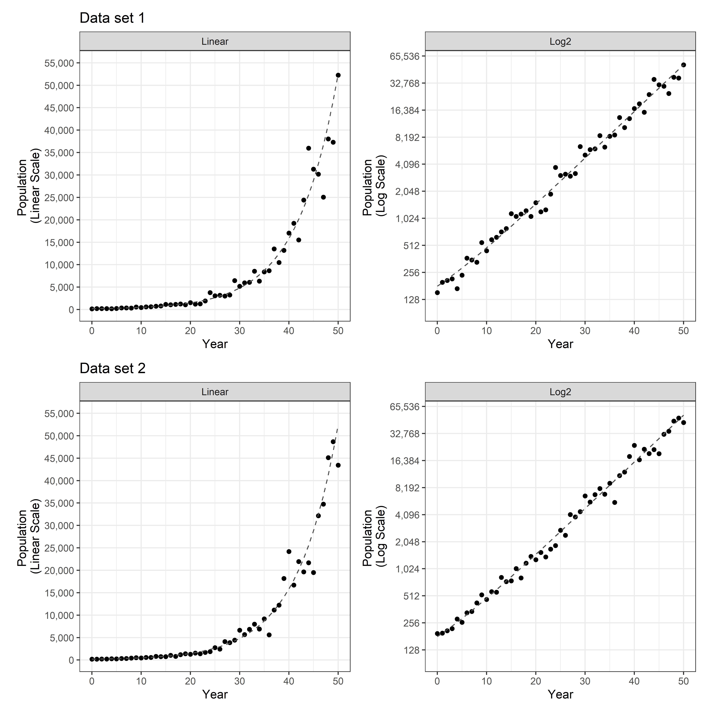
:::

::::

::: notes
<!-- Dissertation basis: §§4.1–4.3, printed pp. 74–80 -->
The first two studies focused on recognizing and extending patterns, independent of a real-world scenario. For the third study, we wanted to understand what happens when people have to translate those visual features into numerical quantities.

We simulated two data sets from the same underlying exponential model and placed them in two fictional population scenarios: Ewoks and Tribbles. For this task, the log scale used base two to support the question about doubling time.

Now the viewer needs to integrate the scenario, axis labels, and scale with what they see in the plot.

**If useful / for questions:**

The scale and data set were randomly assigned to the scenarios within each participant, and scenario order was randomized. The y-axis grid lines increased by 5,000 on the linear display and doubled on the log display. Minor y-axis grid lines were removed. The two data sets had the same underlying parameters but different errors, so the observed point and underlying model value can differ.
:::

<!-- ORIGINAL NOTES RETAINED FOR REFERENCE
<!-- Original speaker notes: index.rmd / Data and plot generation --&gt;
Two unique data sets were generated with the same underlying parameter coefficients, but different errors randomly generated from the same error distribution. Notice in particular that some of the simulated points fall farther from the "true value" or underlying curve. *For example, year 40 in data set 2.*

This figure displays scatter plots of the two unique data sets on both the linear and log base two scales. A log base two was selected in order to aid in participants estimation of time until the population doubled in the third intermediate question. 

I will refer to the time unit as year, but during the study, the time unit labels on the x-axis aligned with the associated popular media depiction of each figure. This was also meant to disguise the use of the same underlying data simulation model and estimation questions across both scenarios.

END ORIGINAL NOTES -->

## Numerical Translation and Estimation: Questions

| Question | Required operation |
|---|---|
| Population in year 10 | Read a population value |
| Year population reaches 4,000 | Read a time value |
| Increase from year 20 to 40 | Subtract two population estimates |
| “How many times more” in 40 than 20 | Compare population estimates by a ratio |
| Time for year-10 population to double | Double a population estimate, then read time |

Calculator inputs and scratch work help identify participants’ strategies.

::: notes
<!-- Dissertation basis: §§4.1–4.2, printed pp. 74–78; §4.4.5, pp. 105–110; Chapter 5, p. 120 -->
We asked an initial open-ended question to encourage participants to explore the graph, followed by two elementary-level and three intermediate-level questions.

The elementary questions involved reading a population or time directly from the chart. The intermediate questions required a comparison: an additive increase, a multiplicative change, or the time required for a population to double.

We also provided a calculator and scratchpad and recorded their use. That gave us insight into how people made their estimates, including the first-level estimates they used before subtracting or dividing.

**If useful / for questions:**

The five quantitative questions were presented in random order. We didn’t focus on advanced-level questioning here because extrapolation had been addressed in the prediction study. The ‘how many times more’ wording was intended to elicit a ratio, but the dissertation acknowledges that ambiguity in language may contribute to misunderstanding. I wouldn’t attribute every incorrect operation to the scale alone.
:::

<!-- ORIGINAL NOTES RETAINED FOR REFERENCE
<!-- Original speaker notes: index.rmd / Numerical Translation and Estimation --&gt;
The previous two studies explored the use of log scales through differentiation and visual prediction of trends. These did not depend on context and instead focused on how our visual system percieves and identifies patterns in exponential growth.

In order to understand the cognitive implications of displaying exponentially increasing data on a log scale, we evaluated graph comprehension as it relates to the contextual scenario of the data shown.

<!-- Original speaker notes: index.rmd / Integrative processes --&gt;
This study involved integrative processes which required viewers to translate the visual features into conceptual relations by interpreting titles, labels, and scales.

An important consideration in understanding graph comprehension is the questions being asked of the viewer. Three levels of graph comprehension have emerged from mathematics education research: literal reading of the data (elementary level), reading between the data (intermediate level), and reading beyond the data (advanced level).

While not exclusive to extracting numerical values from charts, mathematics education also places an emphasis on quantitative estimation skills such as providing an estimated length of a string or weight of a box.

With open ended estimation tasks, certain biases including anchoring and rounding to multiples of five or ten arise. 

+ Beeby & Taylor (1973) found that when asked to read data from line graphs, viewers consistently misread the y-axis scale; when alternate grid lines were labeled, the unlabeled grid lines were read as halves. 
+ The choice of scale can change the shape of a graph, thus creating a conceptual
demand for the viewer when constructing a mental image of the graph (Leinhardt,
Zaslavsky, & Stein, 1990)

<!-- Original speaker notes: index.rmd / Questioning --&gt;
We selected two scenarios and provided text to participants describing a context in which populations of fuzzy fictional characters from star trek and star wars are growing exponentially over periods of time. We wanted to go with a fun context to avoid any personal opinions or biases affecting the results.

We then selected 6 questions related to each scenario. The open ended question was meant to prompt the participants to take time to inspect the graph while the two intermediate questions are related to the literal reading and estimation of population and year respectively. There were three intermediate questions selected to address the additive increase in population between two years, the multiplicative change in population between two years, and the amount of time it took the population to double from a certain year.

We did not focus on advanced level questioning since extrapolation and interpolation were addressed in the second study.

Each of these questions will again be presented in the following slides of results.

<!-- Original speaker notes: index.rmd / Estimation strategy --&gt;
For quantitative estimation questions, we provided basic calculator and scratch pad resources for participants to use. We recorded the inputted and evaluated calculations and scratch work of each participant in order to better understand participant strategies for estimation.

<!-- Original speaker notes: index.rmd / Open ended --&gt;
Before participants were asked to estimate numeric quantities, they were asked to provide an open ended response and describe how the population changed over between year 30 and 40. We used a comparison word cloud to illustrates the general terminology participants used when describing the scatter-plots shown on each scale.

Participants more frequently referred to terms such as ‘exponential’ and ‘rapid’ when shown the scatter plot on the linear scale while ‘double’ and ‘quadruple’ were often used to describe the graphic when shown on the log scale; indicating participants read the y-axis labels and noticed the doubling grid lines.

<!-- Original speaker notes: index.rmd / Estimation of time --&gt;
In addition to estimating the population from a given year, participants were asked, “In what year does the population reach 4,000?” Participants first located 4000 along the y-axis and move to the right until they believe they have found the correct location on the curve; then participants look down to the x-axis for their estimated year.

The density plot shows anchoring occurred to the closest point as shown by an increase in density around the dashed lines as opposed to the solid black line. We also saw density peaks occur at whole values indicating rounding errors.

END ORIGINAL NOTES -->

## Estimation of Population: Elementary Q1

*“What is the population in year 10?”*

::: {.figure-wide}
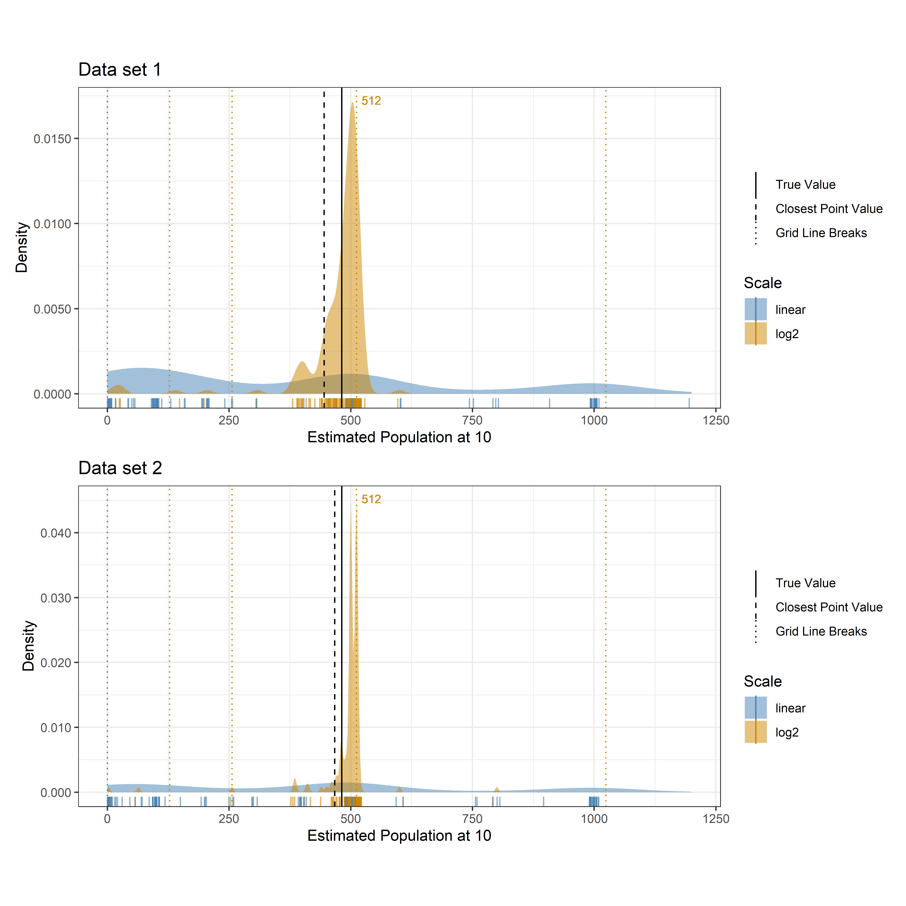
:::

::: notes
<!-- Dissertation basis: §4.4.2, printed pp. 83–90; Figure 4.4 and supplied HTML figure checked -->
For the first elementary question, participants estimated the population in year 10. These density plots show the estimates for the two data sets separately, with blue for the linear scale and orange for the log scale.

The estimates on the linear scale are much more variable. On the log scale, we see strong anchoring around the labeled grid value of 512, as well as the round value of 500.

Year 10 is a small population magnitude, compressed into very little space on the linear display. So this gives support for a benefit of the log scale at this location, but we also need to consider what happens at larger magnitudes.

**If useful / for questions:**

The solid black line is the underlying model value, the dashed black line is the closest simulated point, and the colored dotted lines identify grid breaks. The underlying year-10 population was approximately 481.61; the observed point values were approximately 445.48 and 466.90. The strong mode at 512 reflects both the ease of locating the small population and the tendency to anchor to a grid value.
:::

<!-- ORIGINAL NOTES RETAINED FOR REFERENCE
<!-- Original speaker notes: index.rmd / Estimation results --&gt;
The data set used for analysis contained the unique participant identification and indicated the scenario, scale, data set, and estimation question along with the participant text response or quantitative estimate, calculation input and evaluation, and associated scratch work.

An array of graphical displays allow for visual inspection of participant responses and provide suggestions about the cognitive implications of displaying exponentially increasing data on the log scale.

I am now going to present results from the study as they relate to each of the six questions asked.

<!-- Original speaker notes: index.rmd / Estimation of population --&gt;
In extracting participant first-level estimates from their calculation and scratch work, we observed participants were resistant to estimating between grid lines and had a greater tendency to anchor their estimates to the grid line estimates on the log scale. When estimates between grid lines were made, participant calculations and scratch work revealed a lack of understanding of logarithmic mapping due to considering spatial distance as indicative of numerical distance.

END ORIGINAL NOTES -->

## Additive Increase in Population: Intermediate Q1

*“From 20 to 40, the population increases by ____ [creatures].”*

::: {.figure-wide}
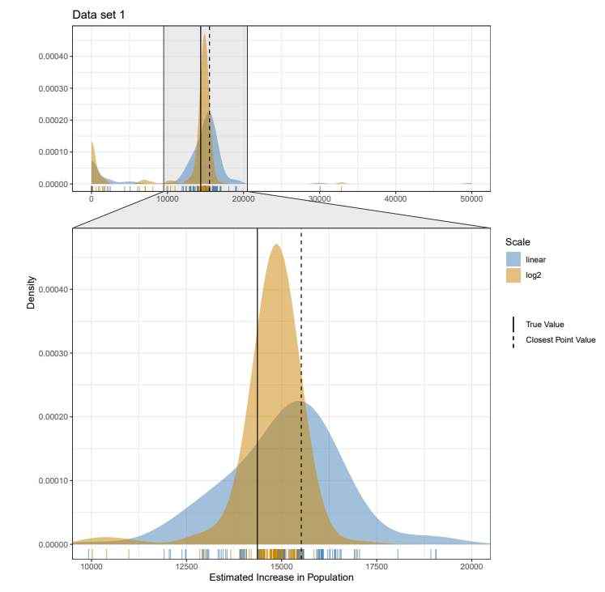
:::

::: notes
<!-- Dissertation basis: §4.4.4, printed pp. 97–104; Figure 4.11; §4.5, p. 117 -->
The additive question asked how much the population increased from year 20 to year 40. To answer, participants needed to estimate the population at each year and then subtract.

Here, for data set one, the linear-scale density is concentrated closer to the difference between the observed points. The log-scale responses are shifted, which is consistent with error in those first-level population estimates.

The important point is that an error in reading one value can carry through into the comparison. Anchoring to grid lines matters more as the numerical gaps between them get larger.

**If useful / for questions:**

Distinguish the two reference lines: the solid line is the increase implied by the underlying model and the dashed line uses the closest observed points. In the dissertation, the linear-scale advantage in this figure refers particularly to the peak near the observed-point difference; it is not a claim that every summary measure improves against every reference. Some participants also gave answers near zero or used a ratio instead of a difference.
:::

<!-- ORIGINAL NOTES RETAINED FOR REFERENCE
<!-- Original speaker notes: index.qmd / Estimation `r fa("ruler")` --&gt;
Each lineup plot evaluated was assigned a value based on the participant response (correct = 1, not correct = 0). The binary response was analyzed using generalized linear mixed model following a binomial distribution with a logit link function. Here we included both main effects and interactions for the curvature combination and scale while account for the participant and data specific characteristics with random effects.

Estimated (log) odds ratio of successfully identifying the target panel on the log scale compared to the linear scale. The y-axis indicates the the model parameters used to simulate the null plots with the target plot model parameter selection designated by shape and shade of green. The thumbnail figures on the right display the curvature combination as shown previously on both scales (linear - left, log - right).

The results indicated the choice of scale changes the contextual appearance of the data leading to slight perceptual advantages for both scales depending on the curvatures of the trend lines being compared.

Out of the study, we save the participant feedback data to a data base for analysis. Here we see a spaghetti plots of results. Participants drawn lines on the linear scale are shown in blue and the log scale are shown in orange. Variability in the statistically fitted regression lines occurred due to a unique data set being simulated for each individual; the gray band shows the range fitted values from the statistically fitted regression lines. Here we can see a strong underestimation on the linear scale (blue lines).

Allowing for flexibility, the we fit a Generalized Additive Mixed Model to estimate smoothing splines for the vertical residuals from the participant drawn line in relation to the NLS fitted values while accounting for participant variability.

The results from the analysis showed a clear underestimation of forecasting trends with high exponential growth rates when participants were asked to make predictions on the linear scale.

<!-- Original speaker notes: index.rmd / Additive increase in population --&gt;
Intermediate level questions required participants to read between the data and make comparisons between points. Participants were asked, “From 20 to 40, the population increases by _______ [creatures].” (Fig. 4.10). The questioning was selected carefully to prompt participants to make an additive comparison of populations between two years.

We saw during the sketch on the previous slide for first level estimates that this procedure required participants to make first-level population estimates at years 20 and 40, then calculate the difference between the two values by subtraction.

These two figures display the density for estimated increases in population as made by participants for data set one and two respectively. 
+ There were a considerable amount of estimated increases near zero indicating that some
participants were misinterpreting the value they were asked to estimate.
+ Estimates for the increase in population between year 20 and year 40 was distinctly more accurate for estimates made on the linear scale as indicated by the peak density occurring near the closest point and true value vertical lines. 
+ The slight shifts in the density on the log scale suggest participants are making inaccurate first-level estimates. One explanation might be that participants were
anchoring to the grid lines much stronger on the log scale as opposed to being more
likely to adjust their estimates between grid lines on the linear scale.

Here we also see the subjectivity of results due to the unique data points as the point associated with year 40 appears much further from the underlying data trend for data set 2 than it does for data set 1.

END ORIGINAL NOTES -->

## Multiplicative Change in Population: Intermediate Q2

*“How many times more [creatures] are there in 40 than in 20?”*

::: {.figure-wide}
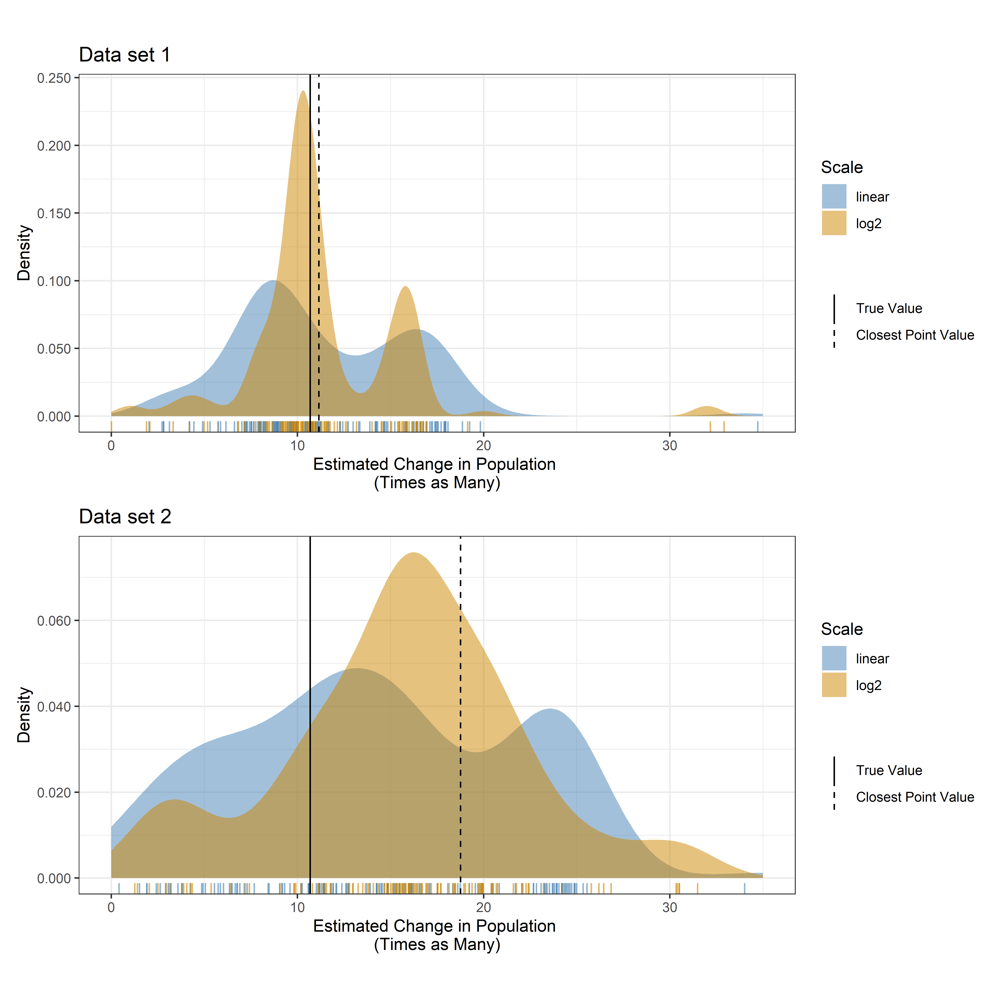
:::

::: notes
<!-- Dissertation basis: §4.4.5, printed pp. 105–112; Figures 4.15–4.17 -->
We then asked for a multiplicative comparison: how many times more creatures were there in year 40 than year 20?

The first-level estimates are the same, but now the operation is division. Among the reasonable ratio responses shown here, estimates on the log scale tended to be more accurate and less variable.

The scratch work also showed that some participants used subtraction rather than division. So we see a combination of issues: reading the values, deciding which operation the question requires, and carrying out the calculation. The wording of the question may contribute to that, alongside the scale.

**If useful / for questions:**

The density plot focuses on reasonable ratio responses. The dissertation separately shows a substantial number of much larger answers that look like additive differences. Those responses are important when interpreting the apparent advantage in the displayed distributions. Some participants used a guess-and-check strategy, multiplying their year-20 estimate until it matched their year-40 estimate.
:::

<!-- ORIGINAL NOTES RETAINED FOR REFERENCE
<!-- Original speaker notes: index.rmd / Multiplicative change in population --&gt;
Participants were asked, “How many times more [creatures] are there in 40 than in 20?” The questioning was selected carefully to prompt participants to make a multiplicative comparison between two years.

Here we see a similar sketch as before where participants make first-level population estimates at years 20 and 40, but then calculate the ratio between the two values rather than the difference.

The density plots shown for each data set separately, show participants tended to be make more accurate and less variable estimates on the log scale than on the linear scale. Evaluating some of the scratch-work for this question, it was interesting to see how many participants used a "guess-and-check" sort of method of multiplying their population estimate from year 20 by different multipliers until they felt the result matched the population at year 40.

<!-- Original speaker notes: index.rmd / Misunderstanding of log logic --&gt;
Overall, there seemed to be misunderstanding of log logic as demonstrated by misinterpretations and miscalculations of the previous two questions. 

This figure displays the observed estimated change in population for Intermediate Q2.The plot shows a substantial number of participants provided estimates that more closely reflected that of the additive increase in population rather than the multiplicative change. We can also see scratch work providing support that miscalculations were made.

However, further investigation is necessary to determine if the misunderstanding occurs due to the ambiguity of language or scale.

END ORIGINAL NOTES -->

## Conclusions

::: fragment
**1. Perception through Lineups** `r fa("chart-line")` `r fa("chart-line")` `r fa("chart-line")`

-   Perceptual differences result from the contextual appearance (depends on choice of scale) of the trends.
:::

::: fragment
**2. Prediction through 'You Draw It'** `r fa("pencil")`

-   Clear underestimation of forecasting trends with high exponential growth rates when participants were asked to make predictions on the linear scale.
:::

::: fragment
**3. Numerical Translation and Estimation** `r fa("ruler")`

-   Log logic is difficult and that we often misinterpret and miscalculate multiplicative reasoning.
-   Estimation accuracy for small magnitudes was improved by the use of the log scale, but sacrifices in accuracy on the log scale became apparent as magnitudes increased leading to advantages on the linear scale.
:::

::: notes
<!-- Dissertation basis: Chapter 5, printed pp. 118–121; original Conclusions notes -->
This research evaluated the use of log scales from three different angles and levels of complexity: perception, prediction, and estimation.

For perception, changing the scale changes the contextual appearance of the trend, with advantages depending on which curvatures are being compared. For prediction, the clearest benefit of the log display occurred with high exponential growth, where linear-scale forecasts underestimated the continuation.

For estimation, we saw that log logic can be difficult. Small magnitudes were easier to locate on the log scale, but anchoring and difficulties estimating between grid lines could create larger numerical consequences as magnitudes increased.
:::

<!-- ORIGINAL NOTES RETAINED FOR REFERENCE
<!-- Original speaker notes: index.qmd / Conclusions --&gt;
This research evaluated the use of log scales to display exponentially increasing data from three different angles and levels of complexity: perception, prediction, and estimation. Each study provided us insight into the advantages and disadvantages of displaying exponentially increasing data on a log scale and in what context each choice of scale might be more appropriate.

The first study laid the foundation for the future studies. Results from this study indicated the choice of scale changes the contextual appearance of the data leading to slight perceptual advantages for both scales depending on the curvatures of the trend lines being compared.

The second study tested participant's abilities to make forecast predictions for exponentially increasing trends on both scales. The results from the analysis showed a clear underestimation of forecasting trends with high exponential growth rates when participants were asked to make predictions on the linear scale and improvements in forecasts were made when participants were asked to make predictions on the log scale.

The third study evaluated graph comprehension as it relates to the contextual scenario of the data shown. Overall, our results suggested that log logic is difficult and that anchoring and rounding biases result in a sacrifice in accuracy in estimates made on the log scale for large magnitudes.

<!-- Original speaker notes: index.rmd / Main take-aways --&gt;
This study was intended to aid in understanding the cognitive implications of
displaying exponentially increasing data on a log scale.

Some of the main take aways from this study are shown here. Overall, we provide argument that understanding log logic is difficult and that the accuracy greatly depends on the location of the value being estimated in relation to the magnitude. 

We found biases related to strong anchoring and rounding effects as participants were resistant to estimate between grid lines on the log scale and had inaccurate representations of equating that spatial distance to the quantitative difference.

This inaccuracy in first-level estimations showed a clear consequence in estimations which required participants to make comparisons between two points. 

The use of two unique data sets allowed us to look at how estimates are very subjective to the simulated data set as some participants are actually reading the data off of the plot and not basing estimates off the underlying trend.

<!-- Original speaker notes: index.rmd / Conclusions --&gt;
This research evaluated the use of log scales to display exponentially increasing data from three different angles and levels of complexity: perception, prediction, and estimation. Each study provided us insight into the advantages and disadvantages of displaying exponentially increasing data on a log scale and in what context each choice of scale might be more appropriate.

The first study laid the foundation for the future studies. Results from this study indicated the choice of scale changes the contextual appearance of the data leading to slight perceptual advantages for both scales depending on the curvatures of the trend lines being compared.

The second study tested participant’s abilities to make forecast predictions for exponentially increasing trends on both scales. The results from the analysis showed a clear underestimation of forecasting trends with high exponential growth rates when participants were asked to make predictions on the linear scale and improvements in forecasts were made when participants were asked to make predictions on the log scale.

The third study evaluated graph comprehension as it relates to the contextual scenario of the data shown. Overall, our results suggested that log logic is difficult and that anchoring and rounding biases result in a sacrifice in accuracy in estimates made on the log scale for large magnitudes.

END ORIGINAL NOTES -->

## Overall Recommendations 

-   Perceptual advantages of the use of log scales due to the change in contextual appearance.

-   Our understanding of log logic is flawed when translating the information into context.

-   We recommend consideration of both user needs and graph specific tasks when presenting data on the log scale.

-   Caution should be taken when interpretation of large magnitudes is required, but advantages may appear when it is necessary to visually identify and interpret small magnitudes on the chart.

::: notes
<!-- Dissertation basis: Chapter 5, printed pp. 121–122; original Overall Recommendations notes -->
Overall, we recommend considering both user needs and the specific graphical task when deciding whether to use a log scale.

There are perceptual advantages from changing the appearance of the data. But seeing a pattern and accurately translating it into numerical information place different demands on the viewer. Caution is especially important when people need to interpret large magnitudes, while a log scale can help when smaller magnitudes would otherwise be compressed.

More broadly, this work provides a model for using a series of graphical tasks to understand the perceptual and cognitive implications of a design choice.

**If useful / for questions:**

The dissertation identifies several directions for further work: other log bases, minor grid lines, data that span orders of magnitude without following an exponential trend, and transformations of the x-axis. The studies here focused on the y-axis. Another direction is interactive visual aids that support estimation strategies, rather than assuming that a static display alone meets every user need.
:::

<!-- ORIGINAL NOTES RETAINED FOR REFERENCE
<!-- Original speaker notes: index.qmd / Overall Recommendations --&gt;
This research evaluated the use of log scales to display exponentially increasing data from three different angles and levels of complexity: perception, prediction, and estimation. Each study provided us insight into the advantages and disadvantages of displaying exponentially increasing data on a log scale and in what context each choice of scale might be more appropriate.

The results are instrumental in establishing guidelines for making design choices about scale which result in data visualizations effective at communicating the intended results.

We recommend understanding the contextual appearance log scales have on the data being displayed and the perceptual advantages and disadvantages that come with each. It is also important to recognize that our understanding of log logic is flawed when translating this information into context.

In general, it is important to consideration of both user needs and graph specific tasks when presenting data on the log scale. Caution should be taken when interpretation of large magnitudes is required, but advantages may appear when it is necessary to visually identify and interpret small magnitudes on the chart.

<!-- Original speaker notes: index.rmd / Packages --&gt;
Thank you to everyone who is attending this morning both in person and online. I will be sharing my Ph.D. work on the human perception of exponentially increasing data displayed on a log scale evaluated through experimental graphics tasks.

<!-- Original speaker notes: index.rmd / Overall Recommendations --&gt;
This research evaluated the use of log scales to display exponentially increasing
data from three different angles and levels of complexity: perception, prediction,
and estimation. Each study provided us insight into the advantages and
disadvantages of displaying exponentially increasing data on a log scale and in what
context each choice of scale might be more appropriate.

The results are instrumental in establishing guidelines for making design choices about scale which result in data visualizations effective at communicating the intended results.

We recommend understanding the contextual appearance log scales have on the data being displayed and the perceptual advantages and disadvantages that come with each. It is also important to recognize that our understanding of log logic is flawed when translating this information into context.

In general, it is important to consideration of both user needs and graph specific tasks when presenting data on the log scale. Caution should be taken when interpretation of large magnitudes is required, but advantages may appear when it is necessary to visually identify and interpret small magnitudes on the chart.

<!-- Original speaker notes: index.rmd / Future work --&gt;
Follow-up studies for this research could provide further insight into the strategies of estimation by providing users the ability to interact with the graph with visual aids such as the arrows shown in sketches from the estimation study and how we make decisions based on data displayed on a log scale to evaluate the effect of scale on risk adversity.

This research stands as a model for conducting an extensive series of graphical tasks on the same type of data and plot in order to gain a comprehensive understanding of both the perceptual and cognitive implications of the design choices.

END ORIGINAL NOTES -->

## Current Work

+ Our recent JDS paper, [*Clusters, Trends, and Choices*](https://doi.org/10.6339/26-JDS1221), explores how viewers use interactive features in statistical lineups.

+ The [`youdrawitR` package](https://alisa-krasilnikov.github.io/youdrawitR/) makes drawing tasks available for graphical studies.

+ I’m also advising an MS project on data narratives, comparing author-driven and reader-driven approaches, including scrollytelling.

::: notes
These questions have continued to shape my work beyond the dissertation.

In our recent paper with Dylan Le and Rachel Rogers, we extended the lineup study to let participants choose which graphical features to display. We were interested in both what they selected and how they used those features.

The youdrawitR package is another piece of this work that I’ll talk more about later.

I’m also advising an MS project looking at how we guide someone through a data narrative. How much should the author direct the story, and how much control should the reader have to explore?

These questions connect to my consulting work, too. We spend time understanding what a collaborator wants to learn from their data. Thinking about how they’ll explore and interpret the results is part of that same conversation.
:::

## Emily A. Robinson {background-color="#003831" background-opacity="0.5"}

### `r fa("envelope", fill = "white")` [erobin17\@calpoly.edu](mailto:erobin17@calpoly.edu){.email}

### `r fa("github", fill = "white")` [github.com/earobinson95](https://github.com/earobinson95)


::: notes
<!-- Dissertation basis: Closing transition -->
Thank you. I’m happy to take questions about the graphical tasks, the modeling, or the implications for how we use log scales.
:::

# Additional details {background-color="#003831"}

::: notes
<!-- Dissertation basis: Backup transition -->
These additional slides provide more detail on the experimental designs, model notation, and estimation strategies if they’re useful for discussion.
:::

## Lineup Study Design: Curvature Combinations

:::: {.columns .figure-pair}

::: {.column width="44%"}
**Three curvature levels:** low, medium, high.

- $3 \times 2 = 6$ ordered target/comparison combinations.
- Two simulated replicates per combination.
- Both display scales: **24 candidate lineups**.
- **12 evaluations per participant**.
:::

::: {.column width="56%"}
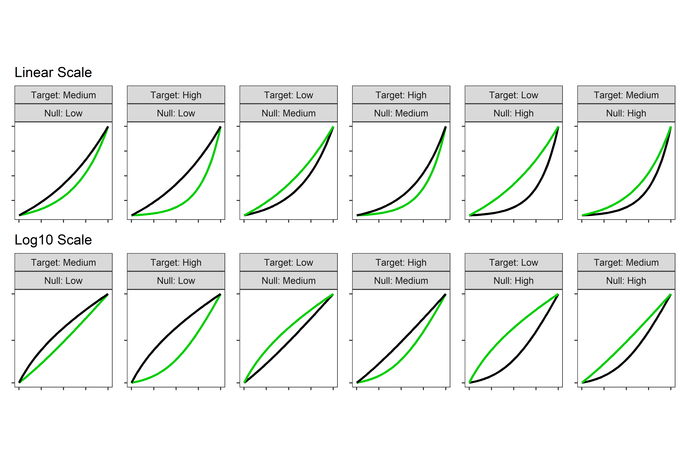
:::

::::

::: notes
<!-- Dissertation basis: §§2.3–2.6, printed pp. 36–41 -->
We used a ‘Goldilocks’ approach to choose low, medium, and high curvature. For each lineup, one curvature level generated the target and another generated the comparison panels. The green curve identifies the target level in these thumbnails.

There are six ordered combinations because reversing the target and comparison roles changes the task. Two replicate lineups per combination, displayed on both scales, gave 24 candidate test lineups. Each participant was assigned one replicate per combination and saw that data set on both scales.

**If useful / for questions:**

We constrained x to 0–20 and y to roughly 10–100, with 50 points per panel, to limit differences in endpoints as a selection cue. Lack-of-fit statistics helped separate the curvature levels numerically, but the dissertation explicitly notes that they are not a direct measure of perceptual discriminability.
:::

<!-- ORIGINAL NOTES RETAINED FOR REFERENCE
<!-- Original speaker notes: index.rmd / Lineup study design --&gt;
We used a 'goldilocks' type of approach to select coefficients related to three levels of curvature (low, medium, and high) for our data simulation. 

The lineups were then created by looking at combinations of each of these curvature levels where the data in the target panel was simulated with equation A and the data in the null panels were simulated with equation B for a total of 6 curvature combinations.

We simulated 2 replicate data sets of each curvature combinations and each data set was plotted on botht he log and linear scales for a total of 24 different lineup plots to select from. Each participant ended up evaluating 12 lineup plots and ideally saw one of each of the 6 curvature combinations on both scales.

END ORIGINAL NOTES -->

## Generalized Linear Mixed Model {.math-slide}

Define $Y_{ijkl}$ to be the event that participant $l$ correctly identifies the target plot for data set $k$ with curvature $j$ plotted on scale $i$.

$$\text{logit }P(Y_{ijk}) = \eta + \delta_i + \gamma_j + \delta \gamma_{ij} + s_l + d_k$$
where
- $\eta$ is the baseline intercept on the logit scale. 
- $\delta_i$ is the effect of the log/linear scale.
- $\gamma_j$ is the effect of the curvature combination.
- $\delta\gamma_{ij}$is the two-way interaction effect of the scale and curvature.
- $s_l \sim N(0,\sigma^2_\text{participant})$, random effect for participant characteristics.
- $d_k \sim N(0,\sigma^2_{\text{data}})$, random effect for data specific characteristics.

We assume that random effects for data set and participant are independent.


<!-- Audit: source uses Y_{ijkl} in the definition but Y_{ijk} in the equation. Equation retained exactly. Source calls eta a probability; its definition above is corrected to logit-scale intercept. -->

::: notes
<!-- Dissertation basis: §2.7, printed pp. 42–44 -->
Each lineup evaluation was assigned a binary value: one for correct target identification and zero otherwise. We analyzed that response using a binomial generalized linear mixed model with a logit link.

The fixed effects are scale, curvature combination, and their interaction. The random effects account for variation due to participant characteristics and the simulated data sets, and we assumed those random effects were independent.

We used glmer from lme4 for the model and emmeans to obtain estimates and odds-ratio comparisons between scales.

**If useful / for questions:**

The dissertation reports a scale-by-curvature interaction with p < 0.0001. I would focus on the interaction-specific contrasts rather than treating the pooled scale percentages as the full result.
:::

<!-- ORIGINAL NOTES RETAINED FOR REFERENCE
<!-- Original speaker notes: index.rmd / Generalized Linear Mixed Model --&gt;
Each lineup plot evaluated was assigned a value based on the participant response (correct = 1, not correct = 0). The binary response was analyzed using generalized linear mixed model following a binomial distribution with a logit link function. Here we included both main effects and interactions for the curvature combination and scale while account for the participant and data specific characteristics with random effects.

END ORIGINAL NOTES -->

## Estimation of Population: Scratch Work

Participant calculations suggest that some viewers equated spatial halfway with numerical halfway.

$$2048-1024=1024$$
$$1024/2=512$$
$$512+1024=1536$$

::: notes
<!-- Dissertation basis: §4.4.2, printed pp. 89–91; participant scratch-work example -->
The scratch work gives us a window into how participants estimated between grid lines. Here, the participant subtracts 1,024 from 2,048, halves that difference, and adds it back to get 1,536.

That calculation treats halfway in space as halfway numerically. On a log scale, those two ideas don’t coincide. We saw similar arithmetic-midpoint calculations at larger values.

This supports the interpretation that some participants were using familiar linear estimation strategies on the log display.
:::

## Backup: estimation design and simulation {.backup}

$\alpha=130,\quad\beta=0.12,\quad\theta=50,\quad\sigma=1.5,\quad x\in[0,50]$

- Two data sets share parameters and differ in simulated errors.
- Scale and data set randomly assigned to the two scenarios for each participant.
- Scenario order randomly selected.
- Open-ended question first, followed by randomized quantitative questions.
- Examples and sketches remained available throughout the study.

::: notes
<!-- Dissertation basis: §§4.2–4.4, printed pp. 76–81 -->
The two estimation data sets used the same underlying parameters but different random errors. Each participant saw one on the linear scale and the other on the log scale, assigned to the Ewok and Tribble scenarios.

The scenario order was randomized. Within each scenario, the open-ended question came first and the quantitative questions followed in random order. Participants also had access to example sketches throughout the task.

That design let us compare scales while using the scenarios to disguise the shared simulation structure and questions.

**If useful / for questions:**

The underlying parameters were alpha = 130, beta = 0.12, theta = 50, and sigma = 1.5 over a 50-year domain. Scenario-specific time labels were 0–50 ABY and 4500–4550 stardates. There were 302 participants in this study, with 145 assigned data set one on the linear scale and data set two on the log scale, and 157 assigned the reverse.
:::

<!-- ORIGINAL NOTES RETAINED FOR REFERENCE
<!-- Original speaker notes: index.rmd / Study design --&gt;
During the study, participants were first shown two examples with associated sketches that were available to them throughout the study.

The scale of the graphic and data set displayed was randomly assigned to scenarios for each individual. 
+ For instance, a participant may have seen a scatter plot of data set two displayed on the linear scale paired with the Ewok scenario text and a scatter plot of data set one displayed on the log scale paired with the Tribble scenario text. 

The order of the two scenarios and their assigned data set and scale was randomly assigned to each individual.

In each scenario, participants were first asked an open ended question, which required them to spend time exploring the data displayed in the graphic, followed by a random order of two elementary level questions and three intermediate level questions.

END ORIGINAL NOTES -->

## Backup: prediction truncation examples {.backup}

:::: {.columns .figure-grid}

::: {.column width="50%"}
### Low growth · Linear
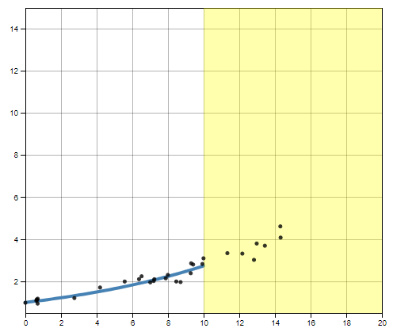

### High growth · Linear
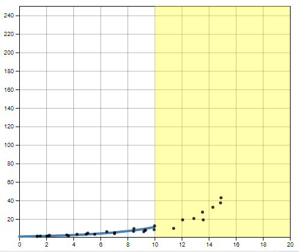
:::

::: {.column width="50%"}
### Low growth · Log
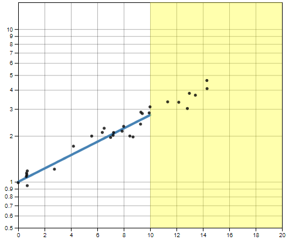

### High growth · Log
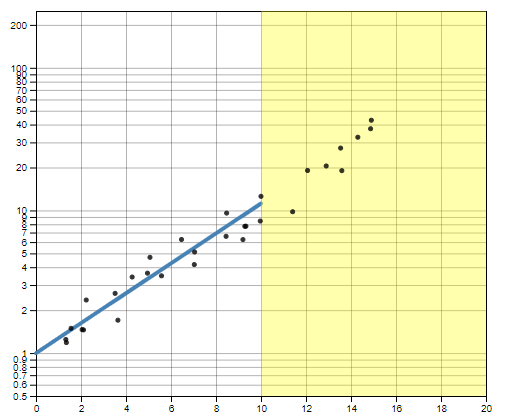
:::

::::

::: notes
<!-- Dissertation basis: §3.4.1, printed p. 68; Appendix B -->
These examples show the condition where points remained visible through 75% of the domain. Participants still began drawing at the midpoint, so they initially had points available to guide their drawing before continuing beyond them.

Comparing these with the 50% condition helps separate the effect of additional visual guidance from the effect of scale and growth rate.
:::

## Backup: first-level estimates across the domain {.backup}

:::: {.columns .figure-pair}

::: {.column width="50%"}
### Data set 1
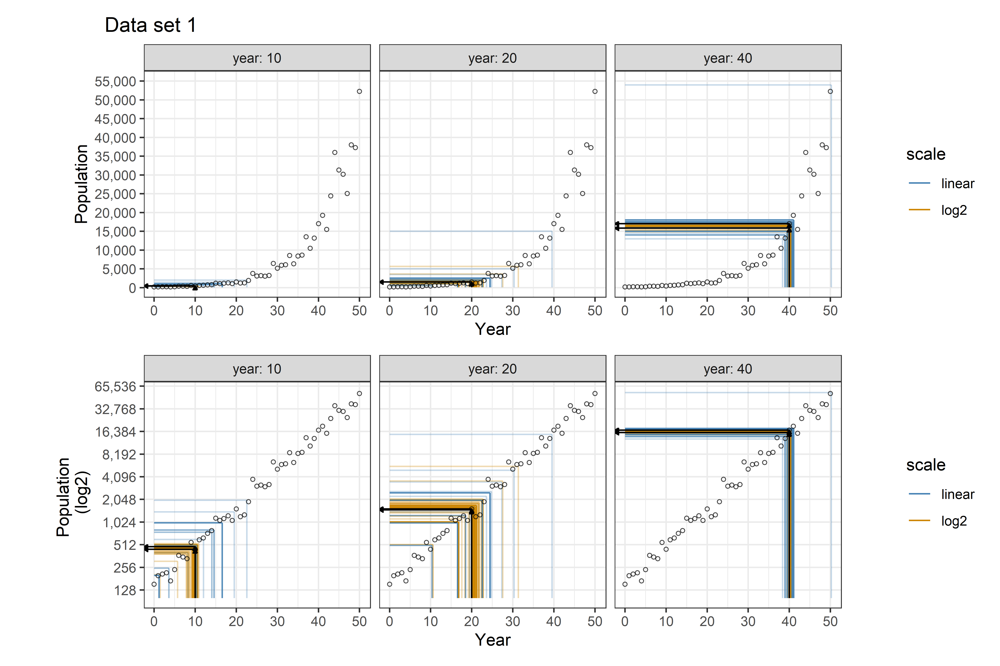
:::

::: {.column width="50%"}
### Data set 2
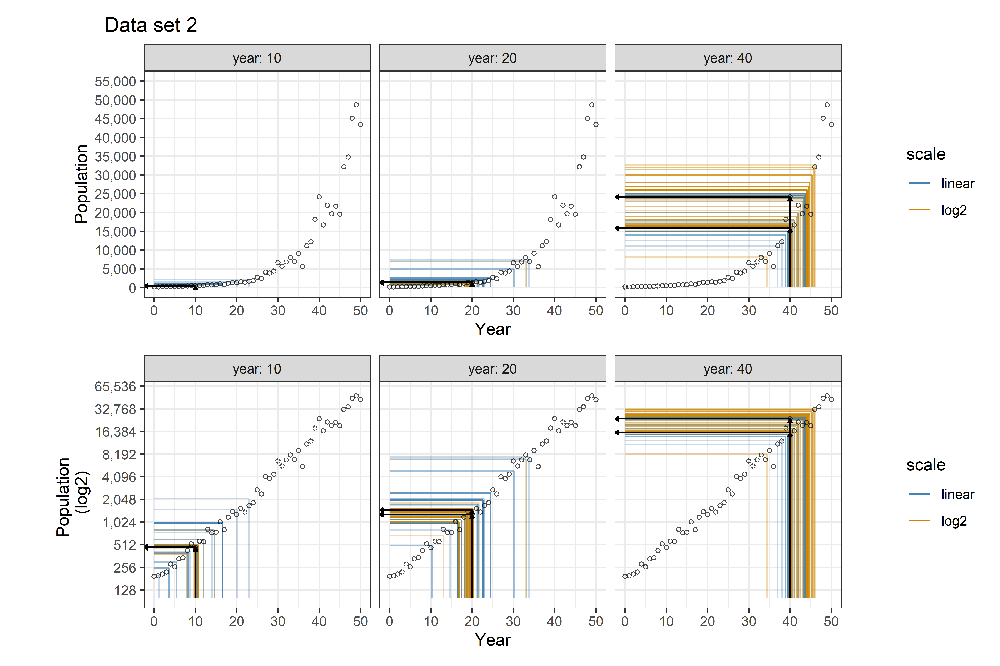
:::

::::

::: {.takeaway}
Tick anchoring can create larger numerical errors at larger magnitudes.
:::

::: notes
<!-- Dissertation basis: §4.4.2, printed pp. 85–93; Figures 4.5–4.7 -->
To understand the effect of magnitude, we extracted first-level population estimates for years 20 and 40 from participant calculations and scratch work, alongside the explicitly requested estimate at year 10.

These plots show the estimates for each data set, displayed on both coordinate scales. The year coordinate is calculated from the underlying model equation using the estimated population; it is a way of displaying the numerical estimate relative to the curve.

As magnitude increased, the linear-scale estimates improved. On the log scale, anchoring to grid lines and difficulty estimating between them created larger numerical consequences.

**If useful / for questions:**

The dissertation compared year-10 estimates for participants who provided scratch work with those who did not and found no substantial difference in those estimates. That supports using the available scratch work to investigate strategies, but it does not mean that we observed every participant’s full reasoning. The particular placement of a point relative to a grid line also matters.
:::

<!-- ORIGINAL NOTES RETAINED FOR REFERENCE
<!-- Original speaker notes: index.rmd / Estimation of population --&gt;
In two estimation questions related to intermediate level reading between the data, participants are asked to provide an increase and change in population between years 20 and 40, thus requiring participants to make first-level estimates at these locations. To understand the effect of the location along the domain and in turn the magnitude of the population being estimated, we extracted first-level estimates for years 20 and 40 from participant calculations and scratch work.


These figures show evaluations of participants estimates of the population at years 10,
20, and 40 for each data set separately. Spaghetti plots are displayed on the linear scale (top) and log scale (bottom) with both scale estimates shown on each - linear (blue), log (orange). The year was calculated from the underlying model equation based on the population estimate provided by the participant. Gray arrows indicate the true value and closest point value as demonstrated in the sketch.

As the year increases, we observe an increased accuracy in estimates made on the linear scale while estimates made on the log scale suffer in accuracy due to strong anchoring to grid lines and the larger quantitative difference between grid lines as population magnitudes increase.
+ For instance, on the log scale, there was a tendency to overestimate the population for year 20 from data set one, underestimate the population for year 20 from data set two, and overestimate the population for year 40 from data set two. This provides argument that estimates are highly subjective to the particular data set.

This is important to recognize becuase inaccurate first-level estimations can lead to consequences in estimations which require participants to make comparisons between two points (e.g. Intermediate Q1 and Q2).

END ORIGINAL NOTES -->

## Backup: time until the population doubles {.backup}

:::: {.columns .figure-pair}

::: {.column width="40%"}
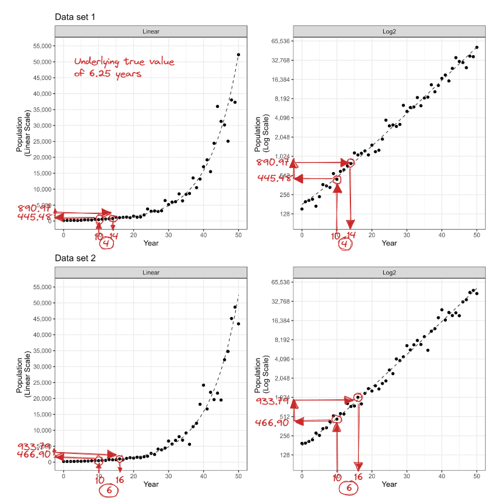
:::

::: {.column width="60%"}
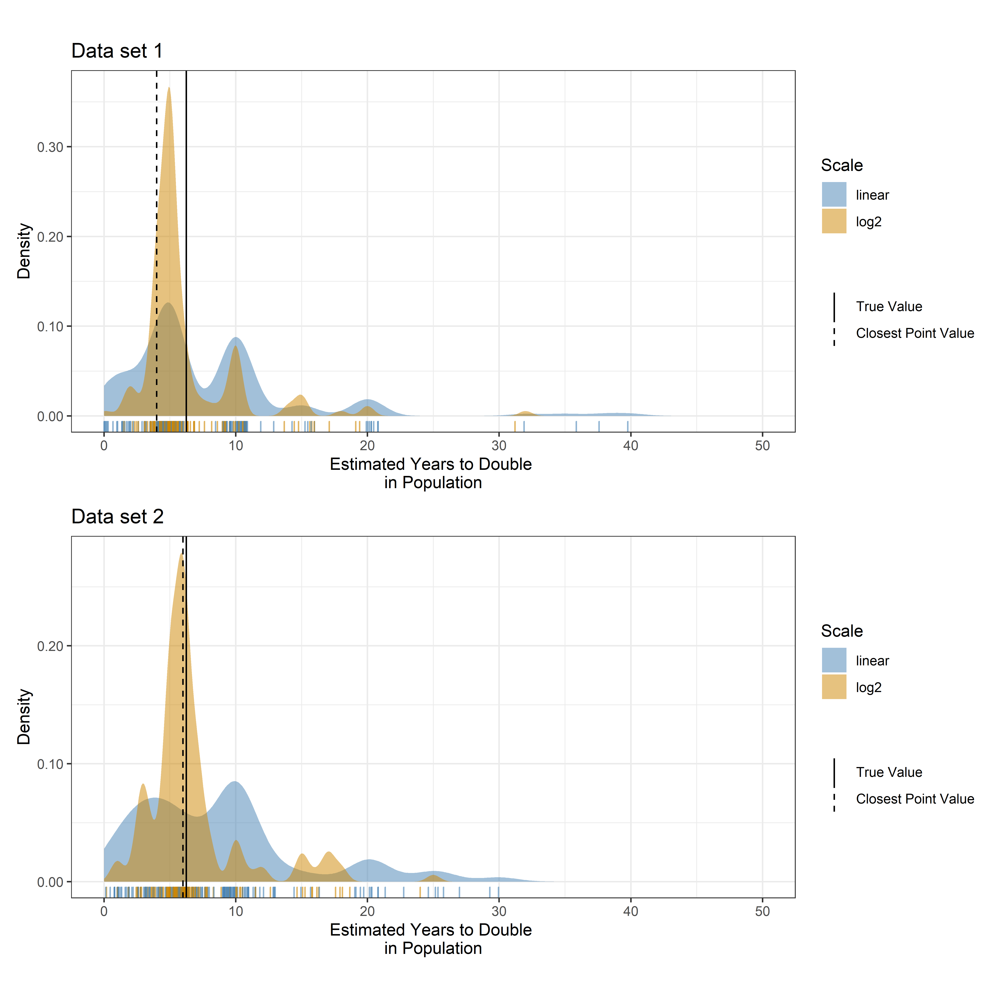
:::

::::

::: {.takeaway}
At the year-10 reference, log-scale doubling-time estimates were less variable.
:::

::: notes
<!-- Dissertation basis: §4.4.6, printed pp. 110–116; Figure 4.19 -->
The doubling-time question required participants to estimate the population at year 10, double that value, locate the year where the population reached it, and then subtract the reference year.

A viewer who understood the base-two grid could also use the spatial distance corresponding to a doubling. The scratch work suggested most participants instead followed the first-level numerical-estimation approach.

We saw lower variability on the log scale, with strong anchoring to multiples of five years. But year 10 was a small-magnitude reference point, so we would need to test other reference years before extending that result more broadly.

**If useful / for questions:**

The model-based doubling time from this reference was approximately 6.25 years. The closest simulated points gave four years for data set one and six for data set two. The shift theta in the simulation means this is a doubling of the total population from a specific reference year; don’t replace it with the constant doubling time of an unshifted exponential.
:::

<!-- ORIGINAL NOTES RETAINED FOR REFERENCE
<!-- Original speaker notes: index.rmd / Time until population doubles --&gt;
An alternative multiplicative comparison between two points was to determine the amount of time it took for a value to double. Participants were asked, “How long does it take for the population in year 10 to double?” 

This required participants to make a first-level population estimate at year 10, then double this population and estimate the year in which that occurs. Lastly, participants subtracted year 10 to determine how long it took for the population to double. Another estimation strategy could involve participants spatially judging the double of population on the log base2 scale; however, examining the scratch-work revealed most participants took the first approach to estimation.

The estimated number of years until the population doubled from a reference year of 10 resulted in lower variability on the log scale as opposed to a larger variability on the linear scale. One explanation might be the low magnitude of population in year 10 and further exploration would be needed to justify for other reference years. Common responses strongly suggest participants were anchoring to multiples of 5 years.

END ORIGINAL NOTES -->

## Backup: additive estimates in the second data set {.backup}

::: {.figure-wide}
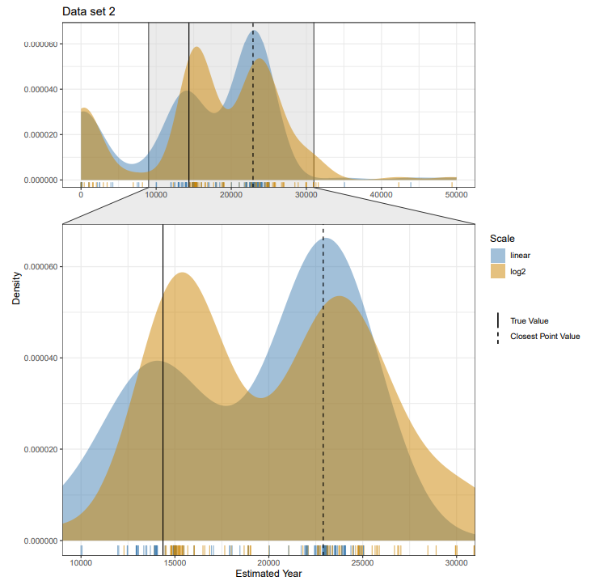
:::

::: notes
<!-- Dissertation basis: §4.4.4, printed pp. 98–104; Figure 4.12; §4.5, p. 117 -->
Data set two makes the distinction between reading the observed points and following the underlying trend especially apparent. The point near year 40 is farther from the underlying model curve, so the two reference differences are separated.

The peaks in participant responses suggest that some viewers based their estimates on the observed data points, while others followed something closer to the underlying trend. So what we call accuracy also depends on which of those references we mean.

The dissertation describes an advantage for the linear display in locating those reference differences, while also showing that responses depend on the particular simulated data set.
:::

## GAMM Results (continued)

::: {.figure-wide}
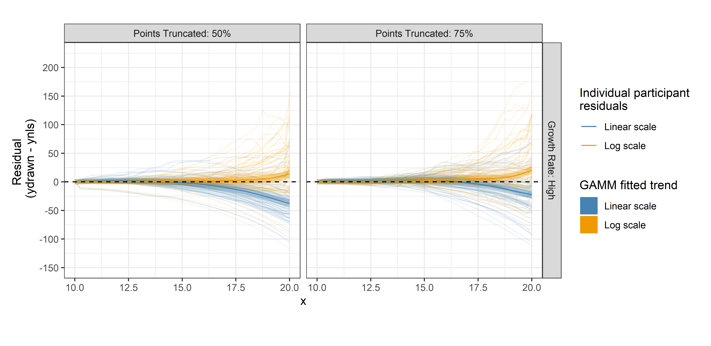
:::

::: notes
<!-- Dissertation basis: §3.4.2, printed pp. 70–73; Figure 3.12 -->
This is the high-growth residual result. Again, zero represents agreement with the nonlinear least squares reference fit, blue is the linear display, and orange is the log display.

Here the underestimation on the linear scale is much more pronounced. When points end at 50% of the domain, the blue fitted residual trend starts moving below zero earlier. When points remain through 75%, that departure happens later.

The log-scale fitted trend stays closer to zero. This is the clearest support for improved forecasts on the log display in the exponential-prediction study.
:::

## Estimation of Population: Procedure

::: {.figure-wide}
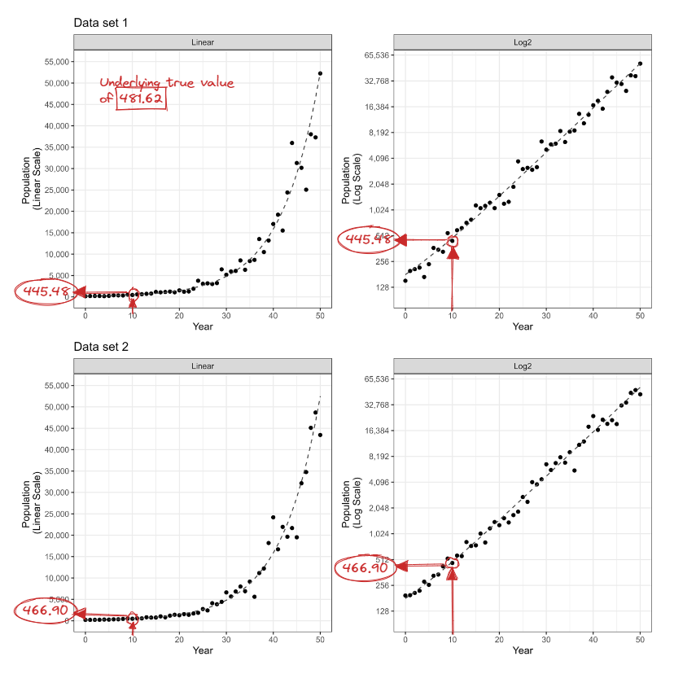
:::

::: notes
<!-- Dissertation basis: §4.4.2, printed pp. 83–85; Figure 4.3 -->
This sketch shows the elementary population-estimation task. A participant first locates year 10 along the x-axis, moves up to the point or perceived trend, and then reads across to the y-axis for a population estimate.

It’s useful to break the task down because error can occur at several stages: locating the point, choosing whether to follow a point or a trend, and translating the position between grid lines into a number. Those first-level estimates then feed into the intermediate comparison questions.
:::

<!-- ORIGINAL NOTES RETAINED FOR REFERENCE
<!-- Original speaker notes: index.rmd / Estimation of population --&gt;
In order to examine the effect of scale on literal reading of the data, participants were asked, “What is the population in year 10?”

Here we see a sketch of the estimation procedure. Participants first locate 10 along the x-axis and move upward until they believe they have found the correct location on the curve; then participants look to the y-axis for their estimated population.

We used density plots were to illustrate the distribution of the quantitative estimates for the population in year 10 provided by participants. The colors are associated to the scale - linear (blue) and log (orange) - and vertical lines indicate the true value based on the underlying model equation (black solid), closest point value based on the simulated data set (black dashed), and grid lines shown on the graphs (blue/orange dotted). A jittered rug plot along the x-axis shows where participant estimates were made. The two unique data sets are shown separately.


The figure reveals a larger variance in quantitative population estimates made on the linear scale compared to the log scale. As expected, it is clear that participants were anchoring to grid lines and base ten values as highlighted by the high density of estimates at 512 and 500 on the log scale as well as local maximums near multiples of ten such as 500 and 1,000.

One such explanation for this difference might be the location of year 10 along the x-axis. This year corresponds to a low magnitude where the population is condensed in a small region on the linear scale as opposed to later in time when larger magnitudes in population can be seen. Thus, it is important to evaluate the accuracy of estiamtes along the full domain.

END ORIGINAL NOTES -->

## References {.refs-slide}

::: {#refs}
:::
::: notes
<!-- Dissertation basis: Reference slide -->
These references provide the background for the graphical testing methods and the work discussed in the presentation.
:::

